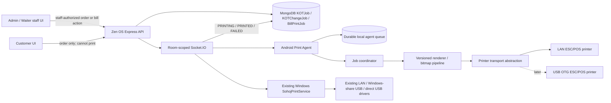

# Zen OS Android Print Agent — architecture design

**Status:** design-only proposal
**Date:** 2026-10-28
**Repository branch observed:** `feature/inventory-v3`
**Existing audit inputs:** `zen-os-mobile-printing-feasibility-report.md`, `zen-os-mobile-printing-executive-summary.md`

> This document describes a future implementation. It does not add an Android project, change the backend, change the Windows service, or certify any printer.

## 1. Design vocabulary

| Label | Meaning |
|---|---|
| **Verified existing behavior** | Directly observed in repository source/configuration/tests. |
| **Source-based inference** | Derived from the observed call graph, but not physically tested. |
| **Proposed design** | A future implementation decision in this document. |
| **Unverified hardware assumption** | Must be tested against a real printer/device. |
| **Open question** | Evidence needed before implementation or product commitment. |

## 2. Executive decision

**Proposed design:** build a separate Android Print Agent, initially for LAN thermal printers, using the current printer-device Socket.IO protocol and the current durable MongoDB print jobs. Keep `SohojPrintService.exe` as a parallel, backward-compatible transport.

The Android agent is a fixed restaurant edge device, not a waiter’s personal phone. It maintains an authenticated outbound connection to the backend and a local durable queue. It connects to printers over the restaurant LAN. USB OTG is a later driver behind the same transport interface after model-specific testing.

### Why LAN first

- **Verified existing behavior:** `print-service/src/drivers/lanDriver.js` uses a TCP interface of the form `tcp://ip:port`, defaulting to port `9100`, through `node-thermal-printer` with Epson printer type.
- **Source-based inference:** an Android LAN driver can implement the same raw-TCP transport without USB host permission, OTG power negotiation, USB interface selection, or printer-class driver conflicts.
- **Unverified hardware assumption:** each target LAN printer must actually accept the selected ESC/POS dialect and raw TCP transport. The repository does not prove that `SP POS893 USD` has LAN capability.

### Why the Windows service remains

- **Verified existing behavior:** the current service has the most complete observed rendering and operational path, including Windows/System.Drawing Bengali rasterization in `print-service/src/textImage.js`, disk queue handling in `src/queue.js`, and USB/LAN drivers.
- **Proposed design:** do not remove or route existing clients away from Windows until Android passes a physical pilot and rollback criteria.

## 3. Existing printing contract reconstruction

| Area | Existing implementation | Actual source evidence | Reusable by Android | Missing capability |
|---|---|---|---|---|
| KOT creation | One KOT job is created when an order enters `PREPARING`; duplicate creation returns the existing job | `restaurant-server/services/orderService.js::sendToKitchenTx`, `restaurant-server/services/kotService.js::createKotJobForOrder` | Yes: preserve `KOTJob._id` as the print identity | No Android routing/lease metadata |
| KOT change slips | Differences become `KOTChangeJob`; printer payload is shaped as KOT | `restaurant-server/services/kotService.js::createKotChangeJob`, `restaurant-server/sockets/socket.js::kotChangePrintPayload` | Yes | Change-job assignment is not explicit per agent |
| Bill job | Staff-only bill route reloads order/profile, creates `BillPrintJob`, then emits `bill:print` | `restaurant-server/routes/adminRoutes.js`, `restaurant-server/controllers/adminController.js::printBill` | Yes: preserve backend bill payload and job ID | No Android-specific capability/version field |
| Live KOT event | Printer room receives `kot:created` with job ID, type, order/table fields, items, notes, and paper-only customer fields | `restaurant-server/sockets/socket.js::emitKotCreated` | Yes | Broadcast semantics can deliver to every printer in the room |
| Live bill event | Printer room receives `bill:print` with job ID and nested payload | `restaurant-server/sockets/socket.js::emitBillPrint` | Yes | Broadcast semantics can duplicate multi-agent delivery unless routing is added |
| Queue pull | Printer socket calls `get-queue`; server returns all pending/printing/failed KOT, change, and bill jobs after expiry | `restaurant-server/sockets/socket.js` `socket.on("get-queue")`; `printerController.js::getPrintQueue` | Yes | Pull is not scoped to station/device |
| Status report | Printer-key socket emits `report-job-status`; server updates KOT/Bill job and printer last-seen state | `restaurant-server/sockets/socket.js` `socket.on("report-job-status")` | Yes | No attempt ID or physical acknowledgement distinction |
| Authentication | Long-lived generated printer key; only SHA-256 hash stored; active device required | `restaurant-server/services/printerDeviceService.js::generatePrinterKey`, `verifyPrinterKey`; `socket.js` handshake | Yes for LAN prototype | Enrollment/rotation UX for Android not present |
| Tenant isolation | Printer socket gets tenant from server-side `MONGO_URI` and joins `rooms.printers(tenantKey)` | `restaurant-server/sockets/socket.js::initSocket` | Yes | Multi-restaurant identity metadata is not client-supplied and should remain server-authoritative |
| Local queue | JSON file persisted after mutation; upsert/dedupe/retry/recovery | `print-service/src/queue.js::PrintQueue` | Conceptually yes; implement with Android database/files | Android durable queue absent |
| Reconnect | Socket connect calls `reconcileQueue`; periodic poll also calls it | `print-service/src/socketClient.js::connect`, `reconcileQueue`; `src/index.js` timers | Yes | Android lifecycle/network constraints need explicit handling |
| Render layout | KOT and bill produce line/image objects; driver converts to ESC/POS | `print-service/src/renderers/kotRenderer.js`, `billRenderer.js`, `layout.js`, `drivers/renderLines.js` | Payload semantics yes; renderer code no direct Windows reuse | Bengali path depends on Windows PowerShell/System.Drawing |
| Bengali | Non-Latin lines are rasterized with Windows font/System.Drawing; failure falls back to `?` | `print-service/src/textImage.js` | Output requirement yes | Android font/shaping implementation missing |
| Logo/QR | Logo and payment QR downloaded/cached and converted to bitmap | `print-service/src/logo.js`, `payQr.js`, `processor.js` | Rendering acceptance fixtures yes | Android bitmap renderer/cache missing |
| Routing | `KOT`, `BILL`, or `BOTH` role picks a configured driver; sample config has one `BOTH` printer | `print-service/src/printerManager.js`, `config.js`, `printers.config.json` | Role concept yes | Station-specific assignment across Android agents missing |
| Expiry | Server expires waiting/printing/failed jobs older than 30 minutes before queue handout | `restaurant-server/services/printerDeviceService.js::expireOldPrintJobs` | Yes; Android must not revive expired jobs | Android UI for skipped/expired jobs absent |

## 4. Proposed component architecture

### Android components

1. **Agent UI / setup activity** — enrollment, printer/station setup, diagnostics, queue state, and a visible connection state. It does not contain admin credentials.
2. **Agent service/controller** — coordinates connection, queue, retry, and printer workers. Use lifecycle-aware components and a foreground service only for the always-on mode that needs continuous delivery.
3. **Backend connection client** — Socket.IO client using a device credential and TLS; subscribes to only the assigned restaurant/device scope.
4. **Local durable queue** — SQLite/Room or an equivalent transactional store. Store job ID, payload version, status, attempt metadata, route, and a bounded error summary; minimize customer PII.
5. **Job coordinator** — idempotent ingest, claim/lease handling when enabled, retry scheduling, and recovery after process/device restart.
6. **Print renderer** — first version should consume a versioned structured payload and produce a normalized intermediate print representation. Bengali lines and images need an Android-supported raster path.
7. **Transport abstraction** — `LanEscPosTransport` first; `UsbOtgEscPosTransport` later. It must serialize writes per printer and return transport-level success/failure.
8. **Printer registry/health** — configured station, printer ID, IP/port or USB selector, paper width, last successful connection, and last error. Never log credentials.

### Backend components

1. Existing KOT/bill job creation and payload authority remain unchanged.
2. Existing printer-key authentication and status path are reused for the first prototype.
3. Future device metadata and station routing may be added narrowly to `PrinterDevice` and queue projection.
4. Optional lease/claim endpoints/events are added only if multi-agent routing cannot be made safe with server-side assignment.

### Existing shared module boundary

No shared Windows module can be copied into Android directly. `print-service/src/renderers/*` depends on Node modules and `textImage.js` depends on Windows PowerShell/System.Drawing. The reusable boundary is the **payload schema and rendering fixtures**, not the Windows runtime code.

### Component diagram



## 5. Lifecycle and operational model

### Startup

- **Proposed design:** load encrypted/local protected agent configuration, verify app version and assigned device ID, open the durable queue, mark interrupted `PRINTING` jobs as `UNCERTAIN`, then connect with exponential backoff.
- **Proposed design:** after connection, call the compatible `get-queue` acknowledgement and reconcile by job ID before processing new live events.
- **Verified existing behavior to preserve:** the Windows queue treats jobs left `PRINTING` after a crash as failed/retryable because physical outcome is unknown. Android should use an explicit `UNCERTAIN` local state or the existing server `FAILED` state plus a diagnostic reason; it must not silently claim success.

### Normal job path

1. Ingest only a valid supported job type and payload version.
2. Upsert by server job ID; ignore a locally terminal job unless reconciliation proves the server intentionally reset/reissued it.
3. Apply station/role routing before printing.
4. Render outside the UI thread.
5. Serialize output per printer.
6. Mark local `PRINTING`, report server `PRINTING` if the contract is unchanged.
7. Write bytes to the printer.
8. Mark local `PRINTED`, report server `PRINTED`.

### Reconnect and offline behavior

- **Proposed design:** Socket.IO reconnect uses bounded exponential backoff; the queue remains local; no job is discarded merely because the network is down.
- **Verified existing behavior:** server-side queue reads expire old waiting jobs at 30 minutes and the Windows service polls every 5 seconds by default. Android must honor the authoritative queue response and not print jobs the server no longer lists.
- **Proposed design:** if a job is missing from a successful server reconciliation and is locally pending/failed, mark it `SERVER_NO_LONGER_LISTED` and surface it for staff review, matching the Windows service’s safe “skipped” behavior.

### Android process/device restart

- **Proposed design:** queue state is committed transactionally before and after each transport attempt. On restart, `PRINTING` becomes `UNCERTAIN`, not automatically guaranteed printed.
- **Proposed design:** the agent resumes only jobs still eligible according to the server’s status/expiry response. Do not replay a job solely because the agent process was killed.

## 6. LAN-first design

### Current evidence

- **Verified existing behavior:** `LanDriver` creates an Epson-type `ThermalPrinter` with `tcp://<ip>:<port>` and default port `9100`, checks reachability, renders lines, and executes the printer buffer.
- **Verified existing behavior:** `printers.config.json` supports `LAN`, `USB`, and `USB_DIRECT` types, while the checked-in example currently uses `USB_DIRECT` with VID/PID `0483:5720`.
- **Source-based inference:** Android can implement a raw TCP transport using the same configured IP/port if the target printer accepts it.
- **Open question:** the reported `SP POS893 USD` printer’s actual interfaces and command language are not confirmed.

### Proposed LAN configuration

Each assigned printer should have:

```text
printerId: server-issued opaque identifier
station: KOT | BILL | BOTH | future named station
transport: LAN
host: private IP or controlled hostname
port: integer, normally 9100 only when verified
paperWidth: 58mm | 80mm or verified dot width
protocol: ESC_POS_Epson | model-specific value after certification
```

The Android agent must never accept printer configuration from an untrusted print job. Configuration is enrolled/admin-controlled, validated, and stored locally with protected storage.

### Network requirements

- The agent and printer must be on a network path that permits the agent to reach the printer’s private IP/port.
- Guest Wi-Fi isolation, AP client isolation, VLANs, firewall rules, and changing DHCP addresses can break the path.
- Prefer DHCP reservation or a printer-configured static address, but do not assume either is available.
- Do not expose port 9100 to the public internet.
- Use a restaurant LAN separate from customer Wi-Fi where practical.

### Foreground service decision

- **Proposed design:** a fixed Android device used for automatic printing should run the agent as a user-visible foreground service only when continuous operation is required, with a persistent notification and clear “printing agent active” state.
- **Verified external constraint:** modern Android restricts background foreground-service starts and requires service-type/permission compliance. The agent must follow the target SDK’s current rules and must not rely on an invisible forever-running background process.
- **Open question:** the target Android version and device-management mode are not yet selected.

## 7. USB OTG as a separate phase

- **Verified external behavior:** Android USB host mode enumerates devices, requires permission, and communicates through interfaces/endpoints using `UsbManager`/`UsbDeviceConnection`.
- **Verified repository behavior:** `usbDirectDriver.js` selects a printer-class interface or bulk OUT endpoint and writes chunks serially, but this is Node/Windows-oriented code and cannot be reused directly in Kotlin.
- **Unverified hardware assumption:** `0483:5720` may be a generic USB printer board, but the repository does not prove the actual model, firmware, or Android behavior.

Required evidence before USB implementation:

- exact manufacturer/model;
- VID/PID and descriptor dump;
- printer class/interface/alternate setting and bulk OUT endpoint;
- ESC/POS or other command language;
- Android phone/tablet USB-host support and Android version;
- OTG adapter and powered-hub arrangement;
- permission after disconnect/reconnect;
- print-head behavior for text, bitmap, QR, cut, and Bengali;
- behavior when another Android driver or system component claims the interface.

## 8. Rendering strategy decision

| Strategy | Bengali | Consistency | Network/payload cost | Recommendation |
|---|---|---|---|---|
| Backend sends complete bitmap | Strong if backend renderer is authoritative | Highest if one renderer is used | Larger payloads; backend must render per paper/printer profile | Good for a later renderer service; not currently available as an Android-ready backend contract |
| Backend sends structured payload; Android renders | Requires Android font/shaping/raster work | Can drift from Windows | Smaller payload, flexible per printer | Required for first Android prototype only if fixtures prove parity |
| Native printer text commands | Poor/unknown for Bengali | Varies by printer code page | Smallest | Not acceptable as primary path for Bengali menus |
| Structured payload plus raster image segments | Strong if glyph shaping is controlled | Good with shared fixtures | Moderate | **Recommended Android approach** |

**Proposed design:** define a versioned intermediate representation containing text cells, alignment, style, image segments, feed, and cut operations. The Android renderer consumes backend-authoritative content and produces printer bytes. The Windows renderer remains unchanged initially. Golden fixtures from `kotRenderer.js`, `billRenderer.js`, `layout.js`, `textImage.js`, `logo.js`, and `payQr.js` should be compared at the intermediate representation and physical output levels.

Do not claim exact byte-for-byte parity between Windows and Android until a fixture and hardware comparison proves it.

## 9. Security and reliability principles

1. **Per-device identity:** use a printer-agent credential, never a staff JWT or admin password.
2. **TLS:** reject insecure backend connections in production; do not put credentials in QR URLs or web storage.
3. **Restaurant binding:** server derives tenant identity from the authenticated device record; ignore client-supplied tenant IDs.
4. **Station authorization:** a device may receive only the assigned role/station jobs.
5. **Payload validation:** enforce supported job type, version, size, item count, image dimensions, and allowed line/image operations.
6. **No arbitrary commands:** the backend payload contains an allow-listed intermediate representation, not arbitrary raw ESC/POS bytes from a customer request.
7. **Bounded queue:** cap local disk usage and define a reconciliation/expiry policy. Never silently delete unprinted jobs.
8. **Deduplication:** key on server job ID; retain attempt IDs for diagnostics if a future lease protocol is added.
9. **Credential revocation:** server checks active/revoked status on connection and rejects future connections after revocation.
10. **Minimal logs:** log job ID, job type, station, printer ID, state, and bounded error class; do not log full customer name/phone/payment data or credentials.
11. **Uncertain outcome:** if transport completion is unknown, surface the job as uncertain and require a policy decision; exactly-once physical printing is not possible without printer-side transactional acknowledgement.
12. **Clock independence:** use server-provided timestamps/status and monotonic local retry timers; do not trust a phone’s wall clock for authorization.

## 10. Acceptance criteria for the architecture phase

Before implementation begins, the design is accepted only when:

- a target printer model and Android device are selected;
- LAN reachability and printer protocol are documented;
- a versioned payload fixture covers KOT, bill, add-ons, AC charge, Bengali, logo, QR, 58 mm, and 80 mm variants;
- agent enrollment/revocation and station routing are defined;
- duplicate/lost-acknowledgement policy is approved;
- Windows compatibility and rollback remain explicit;
- no application source is changed until a non-production test environment exists.

## 11. Official references

Accessed 2026-10-28:

- [Android USB host overview](https://developer.android.com/develop/connectivity/usb/host) — device discovery, permission, interfaces, and endpoints.
- [Android UsbManager reference](https://developer.android.com/reference/android/hardware/usb/UsbManager) — temporary device permission and USB host requirement.
- [Android processes and app lifecycle](https://developer.android.com/guide/components/activities/process-lifecycle) — process lifetime is system-controlled.
- [Android services overview](https://developer.android.com/develop/background-work/services) — background-service restrictions and restart considerations.
- [Android foreground services overview](https://developer.android.com/develop/background-work/services/fgs) — visible notification and foreground-service limits.
- [Android foreground-service launch restrictions](https://developer.android.com/develop/background-work/services/fgs/launch) — Android 12+ background-start restrictions.
- [Chrome WebUSB](https://developer.chrome.com/docs/capabilities/usb) — secure context, user gesture, and permissions policy.
- [Epson ESC/POS Command Reference](https://download4.epson.biz/sec_pubs/pos/reference_en/escpos/index.html) — official command syntax and model-specific scope.
