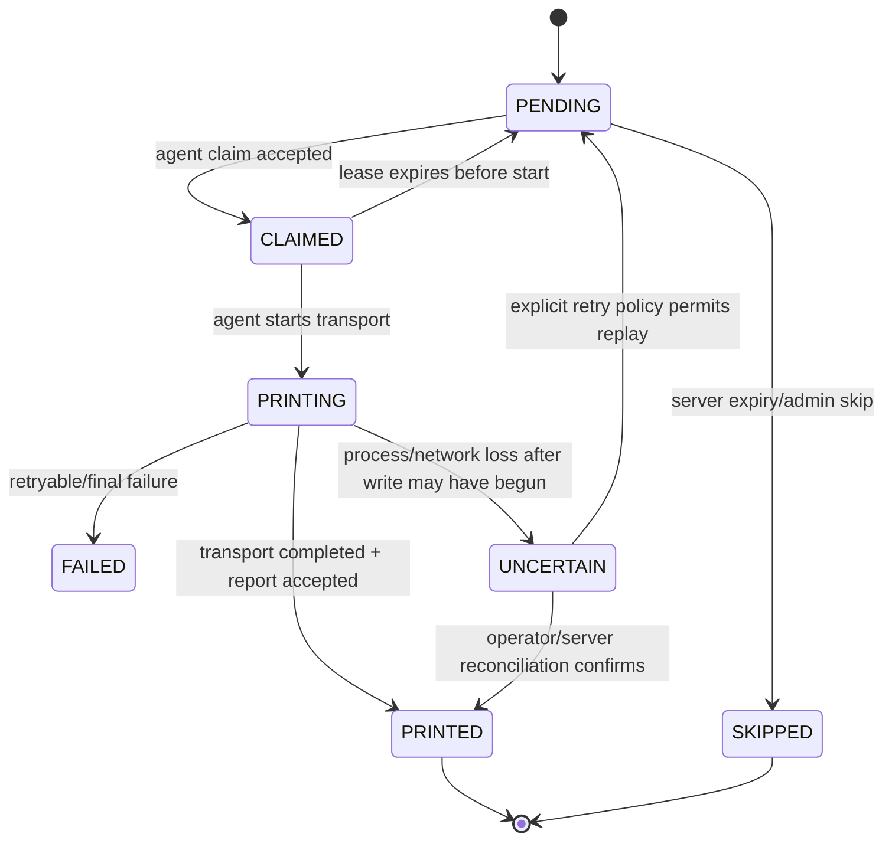

# Zen OS Android Print Agent — backend integration contract

**Status:** design-only proposal
**Date:** 2026-10-28
**Compatibility target:** existing `SohojPrintService.exe` must continue working unchanged during the first Android phase.

> This document defines a future contract. Existing events and payloads below are source-verified; items marked proposed are not implemented.

## 1. Contract labels

- **Verified existing behavior** — observed in repository code.
- **Source-based inference** — behavior inferred from source but not live/physical tested.
- **Proposed design** — new contract or future behavior.
- **Unverified hardware assumption** — requires physical model testing.
- **Open question** — must be answered before implementation.

## 2. Existing wire contract

### Socket authentication

**Verified existing behavior:** `restaurant-server/sockets/socket.js::initSocket` reads `socket.handshake.auth`. If `printerKey` is supplied, it loads the single server database, calls `verifyPrinterKey`, sets `socket.role = "printer"`, sets `socket.isPrinterDevice = true`, derives `tenantKey` from the server-side `MONGO_URI`, and joins the tenant’s printer room. The key is not a staff JWT.

**Verified existing behavior:** `restaurant-server/services/printerDeviceService.js` generates `prn_` keys, stores only SHA-256 `keyHash`, requires device status `Active`, and updates last-seen/status information with `markPrinterSeen`.

### Existing server-to-printer events

| Direction | Event/API | Existing payload/response | Existing source | Limitation for Android/multi-agent |
|---|---|---|---|---|
| Agent → server | Socket.IO `get-queue` with acknowledgement | Request `{}`; response `{ jobs }` or `{ error }` | `restaurant-server/sockets/socket.js` and `print-service/src/socketClient.js::reconcileQueue` | Returns all non-terminal KOT, change, and bill jobs; no station/device claim |
| Server → agent | `kot:created` | `jobId`, `jobType: "KOT"`, order/table/type, items, notes, attempts, priority, customer paper fields, area/table display fields | `restaurant-server/sockets/socket.js::emitKotCreated` | Broadcast to printer room; no assignment filter |
| Server → agent | `bill:print` | `jobId`, `jobType: "BILL"`, order/table/type, nested bill payload | `restaurant-server/sockets/socket.js::emitBillPrint` | Broadcast; all printer sockets can receive it |
| Agent → server | `report-job-status` | `{ jobId, jobType, status, error? }`; no acknowledgement callback | `socket.js` handler and `print-service/src/socketClient.js::reportStatus` | No attempt ID, lease, agent version, or physical acknowledgement class |
| Agent → server | REST `GET /api/admin/printer/queue` | Staff-protected route; returns merged jobs | `restaurant-server/routes/printerRoutes.js`, `printerController.js::getPrintQueue` | Current print service uses socket ack instead; route is not an Android-specific API |
| Staff → server | `GET /api/admin/printer/status` | Queue counters, devices, waiting time, recent failures | `printerController.js::getPrinterStatus` | Dashboard data, not agent control |
| Admin → server | `POST /api/admin/printer/devices` | Creates device and returns plaintext key once | `printerController.js::registerPrinterDevice` | Current UI creates a generic device; no Android enrollment metadata |

### Existing statuses

**Verified existing behavior:** KOT/Bill jobs use `PENDING`, `PRINTING`, `PRINTED`, `FAILED`; Admin can cause `SKIPPED` for stale/cleared jobs, and the server auto-expires waiting/printing/failed jobs older than 30 minutes in `expireOldPrintJobs`. The socket status handler accepts only `PENDING`, `PRINTING`, `PRINTED`, and `FAILED` for a printer report.

**Proposed design:** retain these server statuses for backward compatibility. Keep richer Android-only local states (`RECEIVED`, `CLAIMED`, `TRANSPORTING`, `UNCERTAIN`, `SERVER_NO_LONGER_LISTED`) in the Android queue, or add a backward-compatible `metadata` object rather than changing the existing enum until all clients are updated.

## 3. Design alternatives

### A. Reuse current Socket.IO protocol exactly

- **Verified existing behavior:** the current protocol already supports authentication, queue pull, live push, and status reporting; `print-service/test/integration.test.js` exercises real local Socket.IO connect, queue ack, live KOT push, status report, and reconnect dedupe.
- **Proposed benefit:** fastest LAN prototype and zero change to existing Windows clients.
- **Proposed risk:** every active printer socket in the same printer room can receive the same broadcast, so two active transports can both print one job unless deployment uses one active device or server-side routing.

### B. New Android agent identity over the same Socket.IO server

- **Proposed design:** keep Socket.IO and printer-key authentication, but add device type/version/capabilities/station metadata to the authenticated server record and connection context.
- **Proposed benefit:** narrow credential, same connection technology, straightforward status dashboard.
- **Proposed risk:** metadata alone does not solve assignment or claim races; broadcast must be replaced or filtered for Android-routed jobs.

### C. Claim/lease print-job API

- **Proposed design:** server atomically assigns a job to one eligible device for a short lease; agent renews or completes the lease. Lease expiry makes the job eligible again.
- **Proposed benefit:** explicit multi-agent routing and deterministic ownership.
- **Proposed risk:** a lease cannot prove physical output; a printer may print just before the lease expires or before the acknowledgement is lost. It adds state-machine complexity and requires careful compatibility handling.

### D. Hybrid recommendation

**Recommended:**

1. LAN prototype: reuse the existing printer-key Socket.IO authentication, queue pull, live event names, and status values for one Android agent that is the sole active printer transport for a test tenant.
2. Before allowing Windows + Android coexistence or multiple Android agents: add server-side station assignment and a claim/lease path for new agents. Existing Windows devices remain on their current broadcast-compatible behavior.
3. Use a routing mode that prevents a job from being delivered to both legacy and Android transports unless the Admin explicitly selects redundant printing.

This is a **proposed design** based on the current broadcast contract and the existing durable job model.

## 4. Proposed identity and enrollment contract

### Existing device record reuse

**Verified existing behavior:** `PrinterDevice` already stores a name, hashed key, role (`KOT`, `BILL`, `BOTH`), connection type, LAN IP/port, USB printer name, status, last-seen, and last error in `restaurant-server/config/getModels.js`/`printerDeviceService.js`.

**Proposed additive metadata** (exact field names to be finalized during implementation):

```json
{
  "deviceKind": "WINDOWS_PRINT_SERVICE | ANDROID_PRINT_AGENT",
  "agentVersion": "1.0.0",
  "protocolVersion": 1,
  "capabilities": {
    "lanEscPos": true,
    "usbOtg": false,
    "bitmapLines": true,
    "bengaliRaster": true,
    "paperWidths": [58, 80]
  },
  "stationIds": ["kitchen"],
  "routingMode": "LEGACY_BROADCAST | ASSIGNED"
}
```

**Proposed safety rules:**

- Do not accept `tenantKey`, restaurant ID, station IDs, or role as authoritative from the Android client.
- Admin enrollment creates a device key once, as today; the app stores it in Android protected storage.
- Device status must be checked at every new connection and every claim/queue operation.
- Revoke immediately blocks new connections and future assignment. Existing socket connections should be disconnected or denied on their next authorized operation.
- Do not place the key in a QR code visible to customers or in web localStorage.
- Key rotation is a new enrollment/revoke operation, not a password-reset shortcut.

### Proposed enrollment API

**Suggested new API:** `POST /api/admin/printer/devices` can remain the stable creation endpoint, with an additive request field such as `deviceKind` and optional station/capability configuration. This is a proposed backward-compatible extension, not existing behavior.

Request (proposed):

```json
{
  "name": "Kitchen Android Agent",
  "role": "KOT",
  "deviceKind": "ANDROID_PRINT_AGENT",
  "stationIds": ["kitchen"],
  "routingMode": "ASSIGNED"
}
```

Response (proposed, existing response fields preserved):

```json
{
  "device": {
    "_id": "server-id",
    "name": "Kitchen Android Agent",
    "role": "KOT",
    "connectionType": "LAN",
    "deviceKind": "ANDROID_PRINT_AGENT",
    "routingMode": "ASSIGNED"
  },
  "printerKey": "shown-once-only",
  "warning": "Save this key now — it will not be shown again."
}
```

**Authorization:** existing `requireAdmin` route protection must remain. Do not allow customers, waiters, or Android agents to enroll devices.

**Failure modes:** invalid role/device kind, missing station, duplicate enrollment name policy, unauthorized role, database failure, and key-generation failure must return existing error style without returning the key unless the device was created successfully.

## 5. Proposed assignment and job contract

### Phase 1 compatibility mode

**Proposed design:** the Android agent can initially consume the current `get-queue`, `kot:created`, and `bill:print` shapes only in a test tenant where it is the sole active printer socket. It must send the current `report-job-status` shape, and the backend must continue accepting Windows reports.

This mode is not sufficient for a restaurant with both Windows and Android active in the same printer room.

### Assigned mode

**Proposed new behavior:** server-side assignment selects exactly one eligible device per job role/station before the job is delivered. The old Windows path remains `LEGACY_BROADCAST`; Android-assigned jobs use `ASSIGNED` routing.

Proposed normalized job envelope:

```json
{
  "jobId": "KOT-or-Bill-document-id",
  "jobType": "KOT | BILL",
  "payloadVersion": 1,
  "stationId": "kitchen",
  "printerProfile": {
    "paperWidth": 80,
    "protocol": "ESC_POS_EPSON"
  },
  "createdAt": "ISO-8601",
  "expiresAt": "ISO-8601-or-null",
  "payload": {}
}
```

**Compatibility note:** the current KOT/Bill payload fields must remain available to legacy Windows service. A normalized envelope should be additive or produced by an adapter; do not rewrite historical job documents or existing payloads in place.

**Privacy note:** current printer KOT payloads include `customerName` and `customerPhone` when present because those are intended for paper KOTs. An Android station should receive them only when its assigned printer role is configured to print them. The server must not send them to unrelated stations or to the kitchen app’s existing PII-stripped room.

### Job identity and dedupe

- **Verified existing behavior:** the authoritative identity is the MongoDB job `_id`, stringified as `jobId`; the Windows local queue is keyed by this ID.
- **Proposed design:** dedupe key is `{tenant, jobId}`. Do not use order ID alone because one order can have an original KOT, change slip, and bill jobs.
- **Proposed design:** if claims are added, include `deliveryAttemptId`/`leaseId` for diagnostics, but never use a new attempt ID as the physical dedupe key.

## 6. Proposed lease protocol

The lease path is needed only for assigned/multi-agent mode.

### New event or API choice

**Proposed recommendation:** use Socket.IO acknowledgement events for the live path, backed by atomic MongoDB updates. A REST reconciliation endpoint may be added for diagnostics, but the agent should not require polling every job through REST.

Suggested new events:

| Event | Exists? | Proposed request | Proposed acknowledgement | Auth |
|---|---|---|---|---|
| `print-agent:claim` | New | `{ jobId, stationId, agentVersion, protocolVersion }` | `{ ok, leaseId, leaseExpiresAt, job }` or `{ ok:false, reason }` | Authenticated active Android device; server checks station and job eligibility |
| `print-agent:renew` | New | `{ jobId, leaseId }` | `{ ok, leaseExpiresAt }` | Same device and lease only |
| `print-agent:complete` | New | `{ jobId, leaseId, outcome, errorClass?, renderVersion? }` | `{ ok, serverStatus, accepted }` | Same device and lease; server refuses invalid/revoked leases |
| `print-agent:health` | New | `{ agentVersion, queueDepth, printers[] }` | Optional ack | Same device; bounded fields only |
| `print-agent:reconcile` | New or adapter around existing `get-queue` | `{ knownJobIds, stationIds }` | `{ jobs, skipped, leases }` | Same device |

Suggested outcome values: `PRINTED`, `FAILED_RETRYABLE`, `FAILED_FINAL`, `UNCERTAIN`. The server may map them to existing `PRINTING`, `PRINTED`, or `FAILED` fields while preserving richer audit metadata if added.

### Lease state machine



**Important:** this does not guarantee exactly-once physical output. A printer can accept bytes, then the Android process can lose the acknowledgement. The safe policy is to record uncertainty and require an explicit retry/reconciliation decision rather than silently printing repeatedly.

### Claim transaction requirements

**Proposed:** atomically claim only when:

- job status is eligible (`PENDING` or retryable `FAILED`);
- job is not expired/skipped/printed;
- device is active and assigned to the job station/role;
- no unexpired claim exists;
- payload version/capability requirements match.

The update must include the expected current state in the filter, so two agents cannot both win the same lease. Lease renewal and completion must include both job ID and lease ID.

## 7. Status and acknowledgement semantics

| Event/outcome | Meaning | Server mapping | UI/logging requirement |
|---|---|---|---|
| Agent connected | Authenticated socket is open | Update device last seen/status | No credentials in logs |
| `PRINTING` | Agent started transport; not proof of paper output | Existing `PRINTING`, attempts increment as current handler does | Show station/device if available |
| `PRINTED` | Agent finished its transport write; not necessarily physical paper confirmation | Existing `PRINTED` and `printedAt` | Preserve existing status meaning; do not say “physically verified” |
| `FAILED_RETRYABLE` | Printer/network temporarily unavailable | Existing `FAILED` or pending policy | Bounded error class and retry time |
| `FAILED_FINAL` | Validation/configuration or exhausted retry failure | Existing `FAILED`; operator intervention | Surface actionable reason |
| `UNCERTAIN` | Write may have reached printer but acknowledgement was lost | Keep local; server can retain `PRINTING`/`FAILED` plus metadata until reconciled | Never auto-claim exact output |
| `SKIPPED` | Server expired or operator cleared job | Existing `SKIPPED` | Never resurrect automatically |

The current socket handler has no acknowledgement callback for `report-job-status`. **Proposed:** new `print-agent:complete` should return an ack so the agent knows whether the server accepted, rejected, or already finalized the report. The current Windows event remains unchanged.

## 8. Version compatibility

**Proposed:** every Android connection sends `agentVersion` and `protocolVersion`; the server checks a minimum supported protocol and returns a bounded incompatibility reason. The Android app must refuse to print an unsupported payload version.

Compatibility matrix:

| Backend | Windows service | Android agent | Policy |
|---|---|---|---|
| Existing | Existing | Absent | Current production behavior unchanged |
| New, legacy route | Existing | Phase-1 Android in isolated tenant | Android consumes current wire contract; no mixed active delivery |
| New, assigned route | Existing | New Android | Server routes assigned jobs only to selected device; legacy jobs remain compatible |
| New payload v2 | Old Windows | Old Android | Server must emit v1-compatible payload or hold v2 job from old devices |
| New payload v2 | New Windows | New Android | Roll out only after fixture and hardware tests |

## 9. Reconciliation and retry rules

### Existing protocol reuse

- **Verified existing behavior:** `get-queue` returns all non-done jobs after `expireOldPrintJobs`; `SocketClient.reconcileQueue` drops locally pending jobs missing from a successful server list and ingests listed jobs idempotently.
- **Proposed Android behavior:** implement equivalent reconciliation on every connection and after network recovery; never treat a failed pull as an empty queue.

### Retry

- **Proposed:** use bounded exponential backoff with jitter, a maximum attempt policy, and a maximum job age consistent with the server’s 30-minute expiry unless Admin explicitly changes policy later.
- **Proposed:** distinguish printer offline/paper-out/network timeout from malformed payload/unsupported capability. Only the former should automatically retry.
- **Proposed:** persist next-attempt time and reason in the local queue; avoid hot loops while offline.

### Duplicate prevention

- **Verified existing behavior:** Windows uses one local processing set and one queue record per job ID.
- **Proposed Android behavior:** use a database unique constraint on `{jobId}`; serialize writes per printer; ignore duplicate live/pull deliveries; retain a terminal record until server reconciliation confirms it can be compacted.
- **Limit:** exactly-once physical printing is not provable when the transport outcome is lost.

## 10. Agent health and monitoring contract

**Proposed new health payload:**

```json
{
  "agentVersion": "1.0.0",
  "protocolVersion": 1,
  "queueDepth": 2,
  "oldestPendingAgeSeconds": 18,
  "printers": [
    {
      "printerId": "server-id",
      "stationId": "kitchen",
      "transport": "LAN",
      "online": true,
      "lastErrorClass": null,
      "lastSuccessAt": "ISO-8601"
    }
  ]
}
```

Do not include raw IP credentials, complete order payloads, customer names/phones, payment data, or raw ESC/POS bytes in health events.

The existing Admin `/api/admin/printer/status` dashboard can remain stable initially. A future Admin extension may show `deviceKind`, station, protocol version, and health without exposing keys.

## 11. Backend route and model impact

| Item | Existing/new | Contract rule |
|---|---|---|
| `PrinterDevice` | Existing model, additive future fields | Preserve current records/defaults; no destructive migration |
| `KOTJob`, `KOTChangeJob`, `BillPrintJob` | Existing models | Keep `_id`, status, payload, expiry behavior; add lease metadata only after tests |
| `POST /api/admin/printer/devices` | Existing endpoint | Preserve current request/response; additive Android metadata only for Admin |
| `GET /api/admin/printer/status` | Existing endpoint | Preserve current shape; additive device health fields allowed later |
| Socket printer handshake | Existing | Keep `printerKey`; add protocol/device capability context after authentication |
| `get-queue` | Existing | Keep for Windows and Phase-1 Android; assigned mode may use a scoped response |
| `kot:created`, `bill:print` | Existing | Keep legacy broadcast; route new assigned jobs separately or filter server-side |
| `report-job-status` | Existing | Keep for Windows; do not change accepted status behavior without regression tests |
| Claim/renew/complete | New | Only for assigned Android/multi-agent mode; atomic and lease-bound |

## 12. Acceptance tests for the integration contract

Before implementation is considered complete:

1. Existing print-service integration tests continue to pass, including valid/invalid key, `get-queue`, live KOT, reconnect dedupe, and report status.
2. A device with a revoked key cannot connect or claim jobs.
3. A device cannot claim another restaurant’s job.
4. A KOT device cannot receive a bill-only station job, and vice versa.
5. Two assigned agents cannot both win one claim.
6. Lease expiry makes a job retryable without creating a second job document.
7. Repeated live/pull delivery does not print a terminal job twice locally.
8. A lost completion acknowledgement produces an explicit uncertain state, not a false success.
9. Legacy Windows devices continue receiving compatible legacy jobs.
10. Android payload validation rejects oversized/malformed images and unsupported versions.
11. No customer PII appears in kitchen-room events, health logs, or unrelated station payloads.
12. Device status and queue health remain visible to Admin without exposing credentials.

## 13. Official references

Accessed 2026-10-28:

- [Android USB host overview](https://developer.android.com/develop/connectivity/usb/host)
- [Android `UsbManager` reference](https://developer.android.com/reference/android/hardware/usb/UsbManager)
- [Android process lifecycle](https://developer.android.com/guide/components/activities/process-lifecycle)
- [Android services overview](https://developer.android.com/develop/background-work/services)
- [Android foreground services](https://developer.android.com/develop/background-work/services/fgs)
- [Android foreground-service launch restrictions](https://developer.android.com/develop/background-work/services/fgs/launch)
- [Epson ESC/POS Command Reference](https://download4.epson.biz/sec_pubs/pos/reference_en/escpos/index.html)
