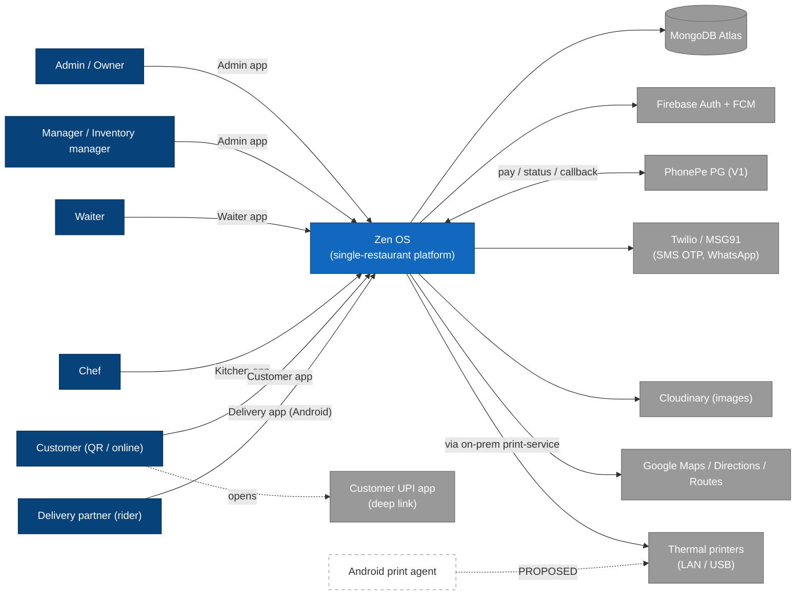

# 03 — System Context

Diagram source: [`diagrams/01-system-context.mmd`](diagrams/01-system-context.mmd) and the `SystemContext` view in [`diagrams/workspace.dsl`](diagrams/workspace.dsl).

## 1. Context diagram (verified actors and systems)

## 2. Actors

| Actor | Role value(s) | How they reach the system | Evidence | Status |
|---|---|---|---|---|
| Owner / admin | `admin` or `isAdmin:true` | Admin app; Firebase phone login → `/api/auth/admin/firebase-login`, or backend OTP `/api/auth/admin/*-otp` (cloud) / PIN (local) | `controllers/authController.js`, `middleware/rbac.js` | IMPLEMENTED |
| Manager | `manager` | Admin app, pages filtered (`admin/src/utils/access.js` `MANAGER_PAGES`) and `requireManagement` routes | `utils/roles.js` | IMPLEMENTED |
| Inventory manager | `inventory_manager` | Admin app, inventory page only | `utils/roles.js:INVENTORY_ROLES`, `access.js` | IMPLEMENTED (undocumented in CLAUDE.md) |
| Waiter | `waiter` | Waiter PWA; employee OTP/Firebase or PIN; must be **on duty** for order actions (`middleware/dutyMiddleware.js`) | | IMPLEMENTED |
| Chef | `chef` | Kitchen PWA; only `CONFIRMED→PREPARING`, `PREPARING→READY` | `utils/orderStateMachine.js` | IMPLEMENTED |
| Other staff | `staff` (custom `jobTitle`) | **No app login** (HR record only) | `getModels.js` userSchema comment | IMPLEMENTED |
| Rider | `delivery` | Delivery app; employee OTP; own `user:{id}` socket room only | `routes/deliveryRoutes.js` | IMPLEMENTED (branch) |
| Customer | `customer` | Customer SPA; Firebase phone login required to **place** an order; browsing/quote is public | `services/orderService.js:174-180` | IMPLEMENTED |
| Print bridge | socket role `printer` | `PRINTER_KEY` handshake | `sockets/socket.js:80-95` | IMPLEMENTED |
| Zen support / operator | — | Restaurant PC console for first-admin bootstrap (LOCAL) | `server.js:359-381` | IMPLEMENTED (LOCAL) |

## 3. System boundary

Inside the boundary: `restaurant-server`, the four web apps, the delivery app, `print-service`, and (LOCAL mode) the restaurant PC's MongoDB replica set. The MongoDB Atlas cluster is treated as an external managed service because its configuration (backups, network access list, tier) is not in the repo (UNKNOWN).

## 4. Two deployment shapes of the same system

| Shape | Writer | Who connects | Status |
|---|---|---|---|
| **CLOUD_PRIMARY** (default) | Cloud backend (Render, inferred) → Atlas | All apps over the internet; print-service on restaurant PC dials out to the cloud | IMPLEMENTED (production) |
| **LOCAL_PRIMARY** (Offline Edition) | Restaurant PC backend → local replica set | Staff/customer devices over restaurant LAN; print-service → `localhost` | PARTIAL (O1+O2 implemented, uncommitted; cloud mirror/sync PLANNED, **not approved**) |

A restaurant runs exactly one shape at a time; switching is a manual cutover (`docs/offline-edition/02-offline-architecture.md` §1, `11-…` §5.2). The two shapes never write the same restaurant concurrently (rule enforced by procedure, not by code — see risk R-12 in [22](22-technical-debt-and-risks.md)).
