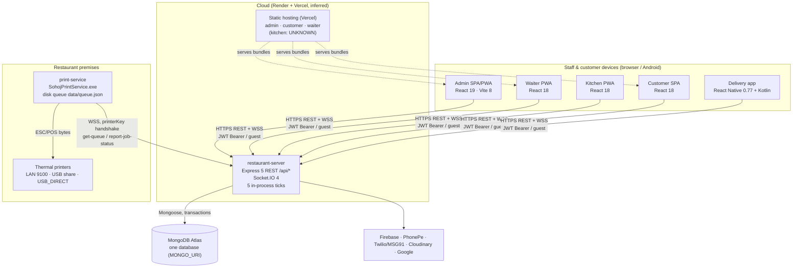
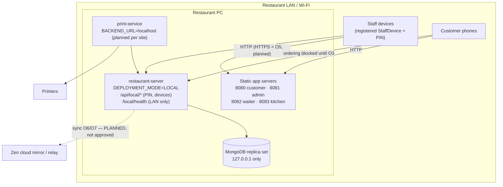

# 04 — C4 Container Architecture

Diagram sources: [`diagrams/02-c4-container.mmd`](diagrams/02-c4-container.mmd), Structurizr `Containers` view in [`diagrams/workspace.dsl`](diagrams/workspace.dsl). Component-level views: [`diagrams/03-c4-component-backend.mmd`](diagrams/03-c4-component-backend.mmd), [`diagrams/04-c4-component-print-service.mmd`](diagrams/04-c4-component-print-service.mmd).

## 1. Container diagram — CLOUD_PRIMARY (production shape)

## 2. Container catalogue

| Container | Technology | Responsibilities | Talks to | Evidence | Status |
|---|---|---|---|---|---|
| **restaurant-server** | Node 22, Express 5, Socket.IO 4, Mongoose 9 | All business rules: pricing, order state machine, payment application, stock, KOT/bill job creation, RBAC, rooms, ticks | MongoDB, all apps, print-service, externals | `server.js`, `services/*` | IMPLEMENTED |
| **MongoDB** | Atlas (cloud) / single-node replica set 7.x (local) | Single store; multi-document transactions (requires replica set) | backend only | `config/db.js`, `config/deploymentMode.js:127-153` | IMPLEMENTED |
| **Admin app** | React 19 SPA, PWA | Management UI (orders, billing, tables, menu, inventory, employees, coupons, offers, insights, delivery, devices) + embedded kitchen display (`/kitchen`) | backend REST + socket | `admin/src/App.jsx`, `pages/admin/*` | IMPLEMENTED |
| **Waiter app** | React 18 PWA | Floor ops: tables, new order, confirm, edit, bill, payment record, duty, waiter calls | backend | `waiter/src/pages/*` | IMPLEMENTED |
| **Kitchen app** | React 18 PWA | KOT board (PREPARING/READY), alert sound, start/ready actions | backend | `kitchen/src/pages/KitchenBoardPage.jsx` | IMPLEMENTED |
| **Customer app** | React 18 SPA (no SW except FCM) | Menu, cart, checkout (dine-in/takeaway/delivery), PhonePe/UPI, tracking, reviews, call waiter, help | backend, Firebase, PhonePe redirect, UPI app | `customer/src/pages/*` | IMPLEMENTED |
| **Delivery app** | React Native + Kotlin | Rider online/offline, offers, accept, pickup, OTP drop, COD, GPS | backend REST + socket, FCM | `delivery-app/src/*` | IMPLEMENTED (branch) |
| **print-service** | Node SEA `.exe` on Windows | Pull/push print jobs, durable local queue, render ESC/POS, drive printers, report status | backend socket; printers | `print-service/src/*` | IMPLEMENTED |
| **Local static app servers** | Node `http` in the backend process | Serve 4 SPA builds on ports 8080–8083 with generated `/config.js` | — | `local/staticApps.js` | IMPLEMENTED (LOCAL only) |
| **Sync agent / cloud ingest / relay** | — | Replicate site → cloud; relay remote orders/riders/PhonePe | — | `docs/offline-edition/05-…` | PLANNED (not approved) |
| **Android print agent** | — | PC-free printing | — | `docs/audit/*` | PROPOSED |

## 3. Container diagram — LOCAL_PRIMARY (Offline Edition, as implemented in O1/O2)

Facts behind the LOCAL diagram: `config/localModeCheck.js` refuses non-loopback / non-replica-set URIs, the public sandbox JWT secret, `OTP_DEV_ECHO`, and a missing/short `LOCAL_PIN_PEPPER` or invalid `LOCAL_SITE_ID`; `server.js:164-167` mounts `/local` and `/api/local` only in LOCAL mode; `server.js:183-191` starts the static app servers and the first-admin bootstrap announcer. Customer ordering on the LAN is blocked by login-required + GPS-required rules until O3 (`docs/offline-edition/19-o3-scope-plan.md` §1).

## 4. Inter-container protocols

| From → To | Protocol | Auth | Notes |
|---|---|---|---|
| Web/mobile apps → backend | HTTPS REST (`/api/*`, JSON, gzip) | `Authorization: Bearer <JWT>`; guests: none or `x-guest-order-token` | CORS `origin:"*"` (`server.js:89-97`) |
| Web/mobile apps → backend | Socket.IO (WebSocket/polling) | handshake `auth.token` (JWT) or none (guest) | rooms assigned server-side |
| print-service → backend | Socket.IO | handshake `auth.printerKey` (SHA-256 hash compared server-side) | ack `get-queue`, event `report-job-status` |
| PhonePe → backend | HTTPS POST `/api/payments/phonepe/callback` | `X-VERIFY` checksum, constant-time compare | no JWT |
| backend → PhonePe | HTTPS `/pg/v1/pay`, `/pg/v1/status/...` | `X-VERIFY` (salt key) | server-derived amount |
| backend → MongoDB | MongoDB wire protocol | URI credentials | transactions need replica set |
| print-service → printer | TCP 9100 (LAN) / Windows share copy (USB) / libusb bulk endpoint (USB_DIRECT) | none | ESC/POS bytes |
