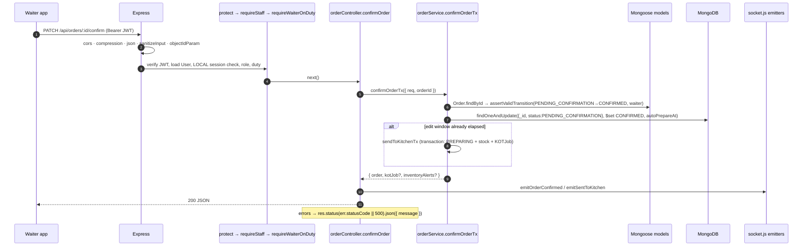

# 06 — Backend Architecture (`restaurant-server/`)

Diagrams: [`diagrams/06-backend-architecture.mmd`](diagrams/06-backend-architecture.mmd), [`diagrams/03-c4-component-backend.mmd`](diagrams/03-c4-component-backend.mmd).

## 1. Layering (verified, High)

```
server.js ─ bootstrap: env → security checks → express app → middleware → routes → error handlers
            → connectDB → listen → (LOCAL) static apps + bootstrap announcer → ticks
routes/*.js        URL → middleware chain (auth, RBAC, duty, rate limit, upload, id validation) → controller
controllers/*.js   thin HTTP wrapper: read req, call a service, map err.statusCode → response
services/*.js      business logic, pure-ish functions taking { models, db, req, … }
config/getModels.js (+ deliveryModels, inventoryV3Models, localAuthModels)  Mongoose schemas bound to one connection
utils/*.js         enums/state machines (orderStateMachine, deliveryStateMachine, attendanceStateMachine),
                   pricing, units, recipeCost, paymentMode, phonePeEnv, roles, tenantKey, tokens, OTP, parsers
sockets/socket.js  Socket.IO auth, room joins, client events, typed emit helpers
local/*.js         Offline Edition only (LAN gate, health, staff login gate, static app hosting)
```

The "services layer, thin controllers" convention (`CLAUDE.md`) holds for the core domains (orders, billing, inventory, payment, delivery, attendance). Some controllers still contain logic (e.g. `adminController.printBill` builds the bill payload and creates the `BillPrintJob` itself — `controllers/adminController.js:562-630`; `profileRoutes.js:29-43` has an inline handler). Medium.

## 2. Middleware chain (global, in order — `server.js:89-107`)

| # | Middleware | Effect |
|---|---|---|
| 1 | `cors({ origin: "*" , allowedHeaders: Content-Type, Authorization, x-guest-order-token })` | Any origin may call the API (bearer tokens, no cookies — so CSRF exposure is low, but no origin allow-list) |
| 2 | `compression()` | gzip |
| 3 | `express.json({ limit: "10mb" })`, `urlencoded` | body parsing |
| 4 | `sanitizeInput` | deletes every `$`-prefixed key from `req.body` at any depth (NoSQL operator injection) |
| — | **ABSENT:** `helmet`, global rate limiter, `trust proxy`, request-ID/logging middleware, schema validator (Joi/Zod/celebrate) | |

Per-route middleware (`middleware/`):

| Middleware | Purpose |
|---|---|
| `authMiddleware.protect` | JWT required → load `User` (minus otp/password) → reject missing/Inactive → LOCAL session check (`checkLocalToken`) → attaches `req.db`, `req.models`, `req.tenantKey` |
| `authMiddleware.optionalProtect` | No token = guest; a token that **is** sent must be valid (fixes "expired staff token silently ordered as customer") |
| `authMiddleware.dbFromHeader` | Public routes: just attach DB/models (name is historical; no header is read) |
| `autoAuth` (defined inline in 6 route files) | `protect` if a Bearer header exists, else `dbFromHeader` |
| `rbac.requireRole(...)` + shorthands `requireAdmin`, `requireManagement`, `requireStaff`, `requireInventory`, `requireInventoryStaff`, `requireKitchen`, `requireDelivery`, `requireEmployee` | role gate; `isAdmin:true` always counts as admin |
| `managerScope.guard*` | router.param guards: a manager cannot act on admin/manager employee records |
| `dutyMiddleware.requireWaiterOnDuty` | waiter must be ON duty for order/billing writes (other roles pass) |
| `validateIds.objectIdParam` | 400 on malformed ObjectId params |
| `rateLimit` | per-process fixed window; used only on `/api/delivery/*` routes |
| `uploadMiddleware`, `importUploadMiddleware` | multer → Cloudinary; in-memory file for OCR import |
| `local/lanOnly.requireLan` / `requireLoopback` | Offline Edition routes: peer must be private / loopback (`req.socket.remoteAddress`, not headers) |
| `local/staffLoginGate.blockInLocalMode` / `blockPinRolesInLocalMode` | in LOCAL mode, OTP/Firebase staff logins are refused (`USE_PIN_LOGIN`) |

## 3. Request lifecycle

Diagram: [`diagrams/06-backend-architecture.mmd`](diagrams/06-backend-architecture.mmd) (sequence). Example — waiter accepts a customer order:



## 4. Domain services inventory (38 files)

| Domain | Services | Key invariants |
|---|---|---|
| Orders | `orderService` (1190 lines), `kotService`, `billingService`, `combinedBillService`, `acServiceCharge`, `payFirstService` | state machine; atomic conditional writes; KOT unique per order; one transaction for PREPARING+stock+KOT; optimistic `revision` on edits |
| Payments | `paymentService` (PhonePe V1), `payFirstService` | verified-only, atomic apply, amount check, final states |
| Menu | `menuItemService`, `menuScheduleService`, `menuStructureService`, `menuTimeService`, `categoryService`, `categoryOrderingService`, `smartCategoryService`, `bestSellerService` | visibility = available ∧ category schedule; sold-out restore inside reads |
| Inventory | `inventoryService` (907), `inventoryV3Operations`, `inventoryV3ReadService`, `inventoryV3SettingsService` | `$gte` guarded decrements; append-only `StockLedger`; V3 off unless `INVENTORY_V3_ENABLED=true` + settings |
| People | `employeeService`, `attendanceService`, `leaveService`, `payService`, `staffReportService`, `reviewService` | one OPEN attendance session per employee; append-only `DutyHistory`; one SALARY per month |
| Customer engagement | `couponService`, `couponOfferService`, `notificationService`, `offerStatsService`, `waiterCallService`, `waitlistService` | coupon live by server clock; one live call per order |
| Tables | `tableSessionService` | one OPEN session per table |
| Printing | `printerDeviceService` | hashed device keys; stale job expiry (30 min) |
| Delivery | `deliveryService` (1254), `deliveryRealtime`, `routeService` | one job per order; accept = one transaction with capacity guard |
| Insights | `insightsService` | revenue = PAID ∧ not CANCELLED; COGS from snapshotted `makingCost` |
| Offline Edition | `localAuthService` (554) | device-bound PIN sessions re-checked every request |

## 5. Transactions (where `session.withTransaction` is used)

`orderService` (send to kitchen, edits after KOT, cancel with stock reversal), `deliveryService` (accept, hand-over), `categoryService`, `categoryOrderingService`, `menuTimeService`, `inventoryV3Operations`, `inventoryController` (purchase/adjust paths), `purchaseImportController`. All require a replica set — enforced for LOCAL mode by `checkLocalMongoUri`; assumed for Atlas.

Not transactional (by design or gap): `placeOrderTx` (single `Order.create`, but the table session is opened **before** the insert and `$addToSet` after it — a failed insert can leave a table OCCUPIED with an empty session; Medium — see R-10), bill print job creation, payment status flips (single atomic `findOneAndUpdate` — adequate).

## 6. Real-time event lifecycle (summary; full map in [10](10-realtime-architecture.md))

1. Handshake middleware (`io.use`) authenticates by `printerKey` → `token` → anonymous guest, and stamps `socket.role/isStaff/isChef/isDelivery/...`.
2. `connection` joins rooms by role. Client events: `join-order`, `join-tracking`, `employee:attendance:heartbeat`, `register-printer`, `get-queue` (ack), `report-job-status`.
3. Services/controllers call typed emitters (`emitOrderStatusChanged`, `emitKotCreated`, …); the emitter writes to the right rooms and swallows errors so a socket failure never fails a request.
4. Single-process only: no Socket.IO adapter (Redis) is configured, so with more than one backend instance, events reach only sockets on the emitting instance (print-service compensates with a 5 s queue poll). (ABSENT adapter — High.)

## 7. Background processing

See [02 §5](02-repository-and-technology-inventory.md#5-background-jobs-all-setinterval-in-serverjs-in-process). Lifecycle: each tick gets the cached connection, calls a service that does atomic conditional updates, then publishes socket effects. Failures are logged and the next tick retries; there is no dead-letter store except `Order.sendError` (auto-send parking) and `NotificationLog.status=FAILED`.

## 8. Validation

* Enum/state validation: Mongoose `enum` on schemas + explicit helpers (`assertValidTransition`, `canSetPaymentStatus`, `parsePaymentSplit`, `validateSchedule`, `parseDeliveryCheckout`, `parseGuests`).
* Price/amount: always recomputed server-side (`utils/pricing.js computeTotals`, `computeCouponDiscount`; `paymentService.expectedAmountPaise`).
* Input shape: hand-written checks per controller (`isText`, regexes). No central schema validator (ABSENT).
* Operator injection: `sanitizeInput` (body only; Express 5's simple query parser does not build nested objects).

## 9. Error handling

* Services throw `Error` with `statusCode`; controllers respond `res.status(err.statusCode || 500).json({ message })`.
* `errorMiddleware.notFound` creates an `Error` but never sets a status, so `errorHandler` maps it to **500** (`res.statusCode === 200 ? 500 : …`) — unknown routes return 500 "Not Found — …" instead of 404 (`middleware/errorMiddleware.js`; confirmed in doc 10 finding 6). Stack traces only when `NODE_ENV=development`.
* Raw `err.message` is returned to clients in many controllers (e.g. `waiterSendOTP` 500 path) — may leak internals (Low).

## 10. Logging and observability

`console.log/error/warn` only (emoji-prefixed). No structured logger, request log, correlation id, metrics, APM or error tracker (ABSENT, High). `/api/health` returns status, time, mode and `RENDER_GIT_COMMIT`. LOCAL mode adds `/local/health` (LAN-only: DB reachable, replica-set primary, served apps).

## 11. Authentication & role permissions

See [16](16-security-architecture.md). Role → capability summary:

| Capability | admin | manager | inventory_manager | waiter | chef | delivery | customer |
|---|:-:|:-:|:-:|:-:|:-:|:-:|:-:|
| Place staff order (starts CONFIRMED) | ✓ | ✓ | – | ✓ (on duty) | ✗ (403) | ✗ (403) | – |
| Place customer order (PENDING_CONFIRMATION / AWAITING_PAYMENT) | – | – | – | – | – | – | ✓ (login) |
| Accept order | ✓ | ✓ | – | ✓ | – | – | – |
| Start preparing / mark ready | ✓ | ✓ | – | ✓ | ✓ | – | – |
| Mark served (READY→DELIVERED) | ✓ | ✓ | – | ✓ | – | ✓ (OTP drop) | – |
| Cancel after kitchen started | ✓ | ✓ | – | – | – | – | – |
| Any-status override | ✓ | – | – | – | – | – | – |
| Mark PAID | ✓ | ✓ | – | ✓ | – | – | – |
| Undo PAID | ✓ | – | – | – | – | – | – |
| Settings, insights, offers, users, printer devices | ✓ | – | – | – | – | – | – |
| Menu/tables/employees/inventory management | ✓ | ✓ | inventory only | – | – | – | – |

Sources: `utils/orderStateMachine.js:112-155`, `utils/roles.js`, `middleware/rbac.js`, route files.
