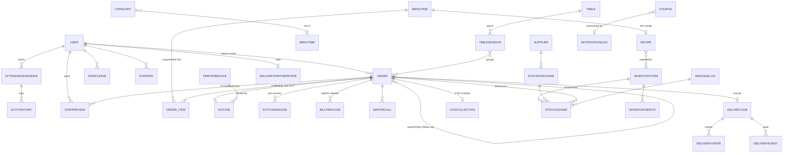

# 08 — Database Relationships

DBML: [`diagrams/schema.dbml`](diagrams/schema.dbml) · ER diagram: [`diagrams/07-database-er.mmd`](diagrams/07-database-er.mmd).

## 1. ER overview (core, cloud collections)

## 2. Relationship inventory

| From | Field | To | Cardinality | Enforced by | Notes |
|---|---|---|---|---|---|
| Order | user | User | N:1 optional | ref only | set to the **logged-in caller** (`orderService.js:349`) — for staff-placed orders this is the waiter/admin, not the diner; the diner is `guestName/guestPhone` |
| Order | items[].menuItem | MenuItem | N:1 | ref only | line fields are snapshots |
| Order | tableSession | TableSession | N:1 | ref | mirrored by `TableSession.orders[]` (two-way, not transactional) |
| Order | parentOrder | Order (root) | N:1 | service (`resolveFollowUpParent`) | always the root, never chains |
| Order | waiterId, *By.id | User | N:1 | ref | actors also snapshot name/role |
| KOTJob | order | Order | 1:1 | **unique index** | idempotency |
| KOTChangeJob | order+revision | Order | 1:N | unique {order, revision} | |
| BillPrintJob | order / combinedOrders | Order | N:1 / N:M | requestKey unique sparse | |
| *Job | printerId | PrinterDevice | N:1 | ref | set by status reports |
| TableSession | table / tableNo | Table | N:1 | unique OPEN per tableNo | `tableNo` is the real join key |
| Recipe | menuItem | MenuItem | 1:1 | unique | |
| Recipe | ingredients[].inventoryItem | InventoryItem | N:M | ref | |
| InventoryItem | supplier | Supplier | N:1 | ref | |
| InventoryBatch | inventoryItem, purchase | InventoryItem, StockPurchase | N:1 | ref | |
| StockLedger | inventoryItem, related* | InventoryItem, Order, StockPurchase, WastageLog | N:1 | ref | |
| Category | menuTime | MenuTime | N:1 | ref | schedule copied |
| MenuItem | category | Category.name / section key | N:1 | **string match** | not an ObjectId |
| AttendanceSession | employee | User | N:1 | unique OPEN per employee | |
| DutyHistory | session, employee | AttendanceSession, User | N:1 | unique {session, action, at} | |
| StaffReview | order, employee | Order, User | | unique {order, kind} | |
| WaiterCall | order, targets[] | Order, User | | unique partial active per order | |
| Coupon | notification | NotificationLog | 1:1 opt | ref | |
| DeliveryJob | order, partner | Order, User | 1:1 / N:1 | unique order | |
| DeliveryOffer | job, partner | DeliveryJob, User | | unique {job, partner, round} | |
| CodCollection | order, job, partner | | 1:1 order | unique order | |
| DeliveryPartnerState | partner | User | 1:1 | unique | |
| Invoice | orders[], user | Order, User | N:M | ref | legacy |
| V3 configs | inventoryItem / supplier | InventoryItem / Supplier | 1:1 | unique (only if setup script ran) | |
| StaffDevice/StaffPin/LocalSession | user, device | User, StaffDevice | | unique user (pin), sid | LOCAL only |

## 3. Data ownership

| Domain | Owning service (sole writer by convention) |
|---|---|
| Order status/lifecycle | `orderService` (+ `billingService` for bill/payment settle, `paymentService.applyPhonePeResult` for PhonePe, `deliveryService` for READY→DELIVERED by rider) |
| Order.paymentStatus | `adminController.updateOrderPayment` → state-machine role check; `billingService`; `combinedBillService.markSelectedPaid`; `paymentService`. **Four writers** — all atomic with `paymentStatus: {$ne: PAID}` filters, but ownership is spread (Medium). |
| Stock | `inventoryService`, `inventoryV3Operations` |
| Print job status | socket `report-job-status` (printer key), `printerController` (manual override), `printerDeviceService.expireOldPrintJobs/skipStale` |
| Table occupancy | `tableSessionService` |
| Duty | `attendanceService` |
| Delivery | `deliveryService` |

## 4. Integrity gaps

* No referential integrity in MongoDB; hard deletes (users, menu items, tables, suppliers, inventory items) can leave dangling refs (see [07 §10](07-database-dictionary.md#10-data-consistency-observations)).
* `Order.tableSession` ↔ `TableSession.orders[]` updated in two separate writes.
* `RestaurantProfile` has no singleton guarantee; `findOne()` picks an arbitrary document if two exist (Low).
