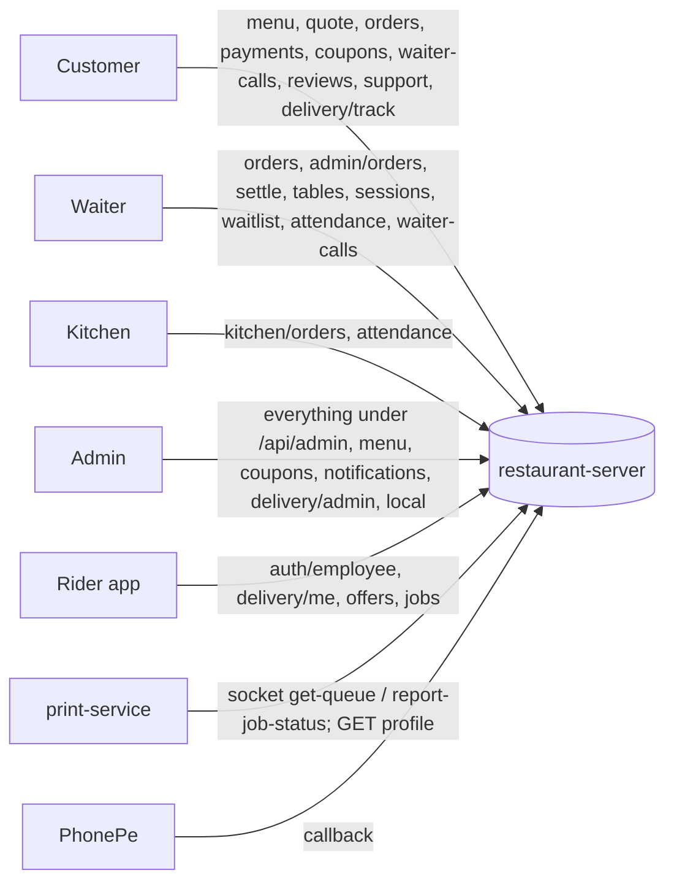

# 09 — API Architecture

Diagram: [`diagrams/08-api-communication.mmd`](diagrams/08-api-communication.mmd).

## 1. Style and conventions (verified)

* REST-ish JSON over HTTPS, all under `/api`. No versioning prefix (except PhonePe paths and planned `/api/sync/v1`). No OpenAPI/Swagger spec (ABSENT).
* Auth header `Authorization: Bearer <JWT>`; guest order access via `x-guest-order-token` (12 h JWT, purpose-bound — `utils/guestOrderToken.js`).
* Errors: `{ message, code? }` with codes such as `SESSION_EXPIRED`, `ACCOUNT_INACTIVE`, `USE_PIN_LOGIN`, `RATE_LIMITED`; status from `err.statusCode` (400/401/403/404/409/429) else 500.
* Concurrency: optimistic `revision` on order edits (409 on mismatch), idempotency keys on order placement and combined-bill print (`requestKey`), Inventory V3 `requestKey` + payload hash.
* 276 route handlers across 25 route files + `/api/health` + `/api/test-whatsapp/:phone` (count by `grep` of `router.(get|post|…)`; `localAuthRoutes` 15 only in LOCAL mode).

## 2. Route groups

| Mount | File | Handlers | Auth pattern | Main consumers |
|---|---|---|---|---|
| `/api/health` | server.js | 1 | public | all apps, probes |
| `/api/auth` | authRoutes | 15 | public OTP/Firebase; `protect` for preferences | all |
| `/api/menu` | menuRoutes | 18 | `autoAuth` reads; `requireManagement`/`requireStaff` writes | admin, waiter, customer |
| `/api/categories` | catagoryRoutes (sic) | 7 | `autoAuth` read; `requireManagement` writes | admin, customer |
| `/api/orders` | orderRoutes | 9 | `optionalProtect`+duty for place/cancel/edit; staff for confirm/approve/reject | customer, waiter, admin |
| `/api/payments` | paymentRoutes | 3 | initiate `optionalProtect`; status `autoAuth`; callback public + X-VERIFY | customer, PhonePe |
| `/api/invoices` | invoiceRoutes | 3 | `protect` (+staff for generate) | admin |
| `/api/admin` | adminRoutes | 25 | `protect` + staff/management/admin | admin, waiter |
| `/api/admin/tables` | tableRoutes | 7 | read `autoAuth`; `/:tableNo/validate` public; writes management | admin, customer |
| `/api/admin/table-sessions` | tableSessionRoutes | 3 | staff | waiter, admin |
| `/api/admin/waitlist` | waitlistRoutes | 5 | staff | waiter, admin |
| `/api/admin/inventory` | inventoryRoutes | 28 | inventory roles | admin |
| `/api/admin/inventory/v3` | inventoryV3Routes | 24 | inventory roles + `requireV3` gate | admin |
| `/api/admin/chefs` | chefRoutes | 5 | admin — **legacy** | (none current) |
| `/api/admin/employees` | employeeRoutes | 25 | `/me/*` employee; rest management + managerScope | admin, waiter, kitchen |
| `/api/attendance` | attendanceRoutes | 7 | employee | waiter, kitchen, admin |
| `/api/kitchen` | kitchenRoutes | 2 | admin/chef | kitchen |
| `/api/admin/restaurant` | profileRoutes | 6 | public GET profile (two paths); admin writes | all, print-service |
| `/api/admin/printer` | printerRoutes | 7 | staff; device CRUD + skip-stale admin | admin |
| `/api/notifications` | notificationRoutes | 7 | protect; admin send/cancel | customer, admin |
| `/api/coupons` | couponRoutes | 8 | live/check optional; admin CRUD | customer, admin |
| `/api/waiter-calls` | waiterCallRoutes | 7 | customer `autoAuth`; waiter staff+duty | customer, waiter |
| `/api/reviews` | reviewRoutes | 2 | `optionalProtect` | customer |
| `/api/support` | supportRoutes | 2 | optional / protect | customer |
| `/api/delivery` | deliveryRoutes | 36 | rider `requireDelivery` + rate limits; `/admin/*` management; `/track/:token` public by IP limit | delivery-app, admin, customer |
| `/api/local` | localAuthRoutes | 15 | LAN only; bootstrap loopback only; device approve management | admin, waiter, kitchen (LOCAL) |
| `/local/health` | local/healthRoutes | — | LAN only | operators (LOCAL) |

## 3. Key endpoints (critical paths)

| Endpoint | Purpose | Server rules |
|---|---|---|
| `POST /api/orders` | place order | login required; server pricing; coupon resolve; service toggles; dining radius (customer dine-in); stock pre-check; pay-first; idempotency |
| `POST /api/orders/quote` | cart price | same pricing, no write |
| `PATCH /api/orders/:id/items` | edit while held / after KOT | revision; role; re-price with coupon snapshot; change slip |
| `PATCH /api/orders/:id/confirm` | accept | PENDING_CONFIRMATION→CONFIRMED atomic |
| `PUT /api/admin/orders/:id/status` | transition | `transitionOrderStatusTx`; PREPARING via `sendToKitchenTx`; COMPLETED needs PAID |
| `PATCH /api/admin/orders/:id/payment` | mark paid / undo | `canSetPaymentStatus`; atomic `$ne: PAID` |
| `POST /api/admin/orders/settle` | settle bills | `billingService.settleBills` (Cash/Online/Both) |
| `POST /api/admin/orders/:id/print-bill` | bill print job | staff; AC charge snapshot at first print |
| `POST /api/admin/combined-bill/print` | one bill for many orders | `requestKey` unique |
| `POST /api/payments/phonepe/initiate` | start PhonePe | amount from `order.total` |
| `POST /api/payments/phonepe/callback` | gateway result | X-VERIFY constant-time; `applyPhonePeResult` |
| `GET /api/admin/printer/queue` | print queue (REST) | includes KOTChangeJob |
| `POST /api/delivery/offers/:jobId/accept` | rider accept | one transaction with capacity guard |
| `POST /api/delivery/jobs/:jobId/:step` | pickup / arrive / OTP drop / fail | step validated by delivery state machine |

## 4. Public (no-auth) surface

`/api/health`, `/api/test-whatsapp/:phone` (**should not exist**, R-03), `/api/auth/*` login steps, `GET /api/menu*`, `GET /api/categories`, `GET /api/admin/tables` (no token), `GET /api/admin/tables/:tableNo/validate`, `GET /api/admin/restaurant/profile` and `/restaurant/profile` (full profile document, R-16), `POST /api/orders/quote`, `GET /api/orders/:id` (guest token checked in service), `POST /api/payments/phonepe/callback`, `GET /api/payments/phonepe/status/:orderId` (autoAuth), `GET /api/coupons`, `/check/:code`, `POST /api/support`, reviews, waiter-call create/state (guest token), `GET /api/delivery/track/:token`, LOCAL `/api/local/devices/register|status`, `/auth/login`.

## 5. API communication diagram (summary)

## 6. Gaps

No API versioning, no spec, no contract tests between apps and backend (only a waiter `kotReleaseContract.test.js`), CORS wildcard, no global rate limiting, 500 for unknown routes.
