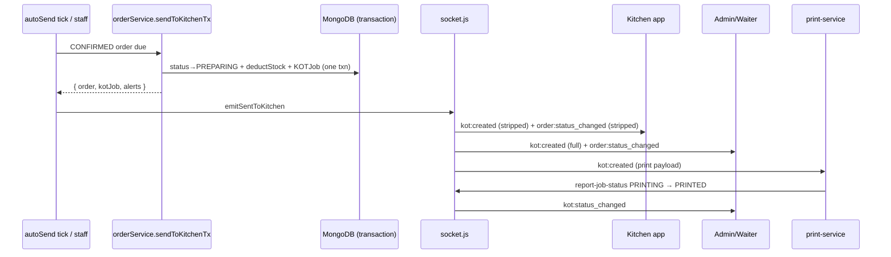

# 10 — Real-time (Socket.IO) Architecture

Source: `restaurant-server/sockets/socket.js` (618 lines), `utils/tenantKey.js`, `services/deliveryRealtime.js`. Diagram: [`diagrams/09-socket-events.mmd`](diagrams/09-socket-events.mmd).

## 1. Handshake authentication (`io.use`, `socket.js:75-145`)

| Handshake | Check | Resulting socket | Status |
|---|---|---|---|
| `auth.printerKey` | `verifyPrinterKey` (SHA-256 hash, device Active) | role `printer`, joins `printers` | IMPLEMENTED |
| `auth.token` (JWT) | `jwt.verify`, `User` exists; LOCAL: Inactive refused + `checkLocalToken`; **cloud: Inactive not checked (R-04)** | role from user; flags isStaff/isChef/isDelivery/isDeliveryAdmin | IMPLEMENTED |
| nothing | — | role `guest`; `auth.dbName` accepted and ignored | IMPLEMENTED |

CORS on the socket server: `origin: "*"`. No Redis adapter (single instance). LOCAL: socket disconnected when its PIN session expires; `disconnectLocalSessions` cuts revoked sessions.

## 2. Rooms

| Room | Joined by | Payload class |
|---|---|---|
| `tenant:{key}` | **every** socket incl. anonymous guests | intended: presence + `menu:updated`; **actual: also legacy full-order events (R-02)** |
| `…:staff` | admin, manager, waiter | full orders, payment, PII, KOT/bill, attendance, waitlist, inventory alerts |
| `…:kitchen` | chef only (admin does **not** join — differs from docs) | PII-stripped orders (`toKitchenSafeOrder`), `kitchenSafeKot` |
| `…:printers` | printer-key sockets; staff via `register-printer` | print payloads incl. customer name/phone (paper only) |
| `…:order:{id}` | staff on request; guest with valid guest token; owner customer | one order |
| `…:user:{id}` | staff and riders (own id) | waiter-call rings; rider offers/jobs |
| `…:delivery-admin` | admin, manager | rider GPS, delivery board |
| `…:track:{jobId}` | holder of valid tracking token | status + rider position only |

`{key}` = database name from `MONGO_URI` (`tenantKeyFromUri`), never the URI.

## 3. Client → server events

| Event | Allowed | Effect |
|---|---|---|
| `join-order {orderId, guestOrderToken?}` | staff; valid guest token; owning customer | joins order room |
| `join-tracking {token}` (ack) | anyone | verified server-side → track room |
| `employee:attendance:heartbeat` | staff, chef | `AttendanceSession.lastSeenAt` update (no auto-OFF) |
| `register-printer` | staff | joins printers room |
| `get-queue` (ack) | printer | expires >30 min jobs, returns PENDING/PRINTING/FAILED KOT + bill + change slips |
| `report-job-status {jobId, jobType, status, error}` | printer | atomic status update (SKIPPED kept unless PRINTED), `attempts` inc, device seen; emits `kot|bill:status_changed` to staff |

## 4. Server → client events

| Event | Rooms | Emitter | Listeners (verified by grep) |
|---|---|---|---|
| `order:new` (+`playSound`) | staff | `emitNewOrderPendingConfirmation`, `emitPayFirstPromoted` | admin, waiter |
| `order:confirmed` | staff, order | `emitOrderConfirmed` | admin, customer (kitchen listens but never receives) |
| `order:status_changed` | staff, order, kitchen (stripped) | `emitOrderStatusChanged`, `emitOrderModified`, `emitKitchenOrderModified` | admin, customer, kitchen |
| `order:cancelled` | staff, order, kitchen (stripped) | `emitOrderCancelled`, `emitPayFirstExpired` (order only) | admin, waiter, kitchen, customer |
| `order:payment_changed` | staff (unless AWAITING_PAYMENT), order | `emitPaymentStatusChanged` | admin, customer |
| `order:needs_attention` | staff | `emitOrderNeedsAttention` | admin, waiter |
| `kot:created` | staff (full), kitchen (stripped), printers (print payload) | `emitKotCreated`, change slips → printers | admin, kitchen, print-service |
| `bill:print` | staff, printers | `emitBillPrint` | print-service |
| `kot:status_changed` / `bill:status_changed` | staff | report-job-status | (no current listener found) |
| `table:cleared`, `table:freed`, `waitlist:updated` | staff | table/waitlist services | admin (freed, waitlist) |
| `inventory:alert` | staff | `emitInventoryAlert` | (no listener found) |
| `employee:attendance:updated` | staff | `emitAttendanceUpdated` | admin, waiter |
| `menu:updated` | tenant | `emitMenuUpdated` | admin, customer, waiter |
| `waiter_call:new/updated` | target user rooms; order room (customer state) | `emitWaiterCall` | waiter, customer |
| `waiter_call:activity` | staff | same | (admin notification panel) |
| `delivery:*` (request_received, accepted, already_assigned, request_expired, job_updated, job_removed, completed, capacity_updated, cash_updated, presence, status_updated, location_updated) | rider user room, delivery-admin, track + order rooms | `deliveryRealtime.publishDeliveryEffects` | delivery-app, admin, customer |
| `auth:session_ended` | the revoked socket | `disconnectLocalSessions` | LOCAL apps |
| **Legacy:** `new-order`, `order-status-updated`, `order-rejected` (tenant — **PII leak**), `order-approval-request`, `kot-print`, `bill-print` (staff) | | | **no listener in any app** |

## 5. Event lifecycle — order to kitchen to printer

## 6. Reliability properties

* Emits are fire-and-forget after commit; failures are logged, never fail the request.
* No server-side replay for missed events: apps re-fetch on reconnect/visibility (hooks like `useLiveOrders`, `useVisibleInterval`); print-service reconciles through `get-queue` on connect and every 5 s.
* Single instance assumption (no adapter).
