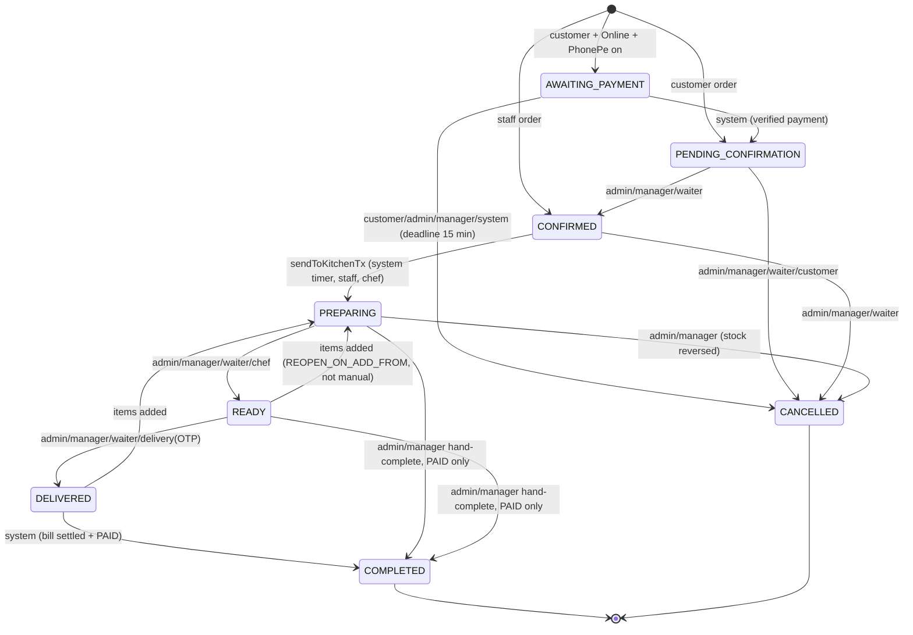
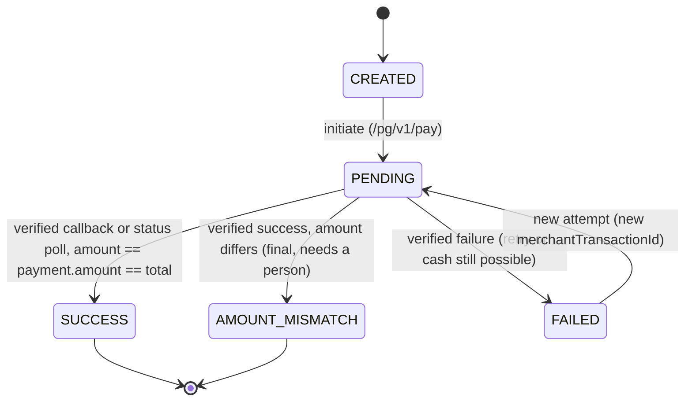

# 12 — Order and Payment Lifecycles

Diagrams: [`diagrams/10-order-lifecycle.mmd`](diagrams/10-order-lifecycle.mmd), [`diagrams/11-payment-lifecycle.mmd`](diagrams/11-payment-lifecycle.mmd).

## 1. Order status (`utils/orderStateMachine.js`) — IMPLEMENTED, High



Admin override: any → any (except COMPLETED rules) as a pure status flip without side effects (`validateTransition` `role === "admin"`). Every transition appends `statusHistory` with an actor. Guard detail: `validateTransition` skips the role check if `role` is falsy (`allowedRoles && role && …`) — callers always pass a role today (Low).

## 2. Payment status (`Order.paymentStatus`)

```mermaid
stateDiagram-v2
  [*] --> PENDING_VERIFICATION
  PENDING_VERIFICATION --> PAID: staff mark/settle (admin, manager, waiter)
  PENDING_VERIFICATION --> PAID: PhonePe verified SUCCESS + amount match
  PENDING_VERIFICATION --> PAID: admin verifies COD hand-in (settleBills)
  PAID --> PENDING_VERIFICATION: admin undo
  note right of PENDING_VERIFICATION: FAILED exists only for historic data;\na failed PhonePe attempt leaves this state
```



`paidBy/paidAt` are written only in the same atomic update that flips to PAID (filter `paymentStatus: {$ne: PAID}`).

## 3. PhonePe attempt (`Order.payment.state`) — PhonePe PG **V1**



### Sequence — pay-first online order

```mermaid
sequenceDiagram
  participant C as Customer app
  participant API as Backend
  participant PP as PhonePe
  participant T as pay-first tick (60 s)
  C->>API: POST /api/orders (Online) → AWAITING_PAYMENT, paymentDeadline +15 min
  C->>API: POST /api/payments/phonepe/initiate
  API->>PP: /pg/v1/pay (amount = order.total×100, X-VERIFY)
  API-->>C: redirect URL
  C->>PP: pay
  PP->>API: POST /phonepe/callback (X-VERIFY)
  API->>API: verify checksum (timingSafeEqual) → applyPhonePeResult (atomic, final states)
  API->>API: promotePaidOrder → PENDING_CONFIRMATION, join table session
  API-->>C: order:status_changed; staff get order:new
  C->>API: GET /phonepe/status/:orderId (on return) → signed status query
  T->>API: promote stragglers / last live check → cancel unpaid after deadline
```

### Security properties (verified)
Redirect never trusted; amount server-derived; callback without JWT but checksum-verified; constant-time compare; final states immutable; unknown `PHONEPE_ENV` disables the gateway (`utils/phonePeEnv.js`); secrets only in `.env`; public profile exposes only `phonePeEnabled`.

### Gaps (PLANNED in `docs/phonepe-integration/`)
V2 OAuth API (G1–G5), reconciliation of `payment.state=PENDING` beyond AWAITING_PAYMENT orders (G8), **refunds (G10 — none today; paid-after-cancel needs manual handling)**, admin re-check endpoint (G11), webhook IP allow-list (G12). No separate transaction/ledger collection: the attempt lives on the order and is overwritten by the next attempt (Medium — limited audit trail).

## 4. Other payment paths
| Path | Proof of payment | Status |
|---|---|---|
| Cash | staff action | IMPLEMENTED |
| UPI deep link / static QR | **never** proof; staff mark PAID | IMPLEMENTED |
| Split `Both` | staff, one bill, `parsePaymentSplit` sums to total | IMPLEMENTED |
| COD (delivery) | rider custody (`CodCollection`) → admin verify → PAID | IMPLEMENTED (branch) |

## 5. Bill lifecycle
`billStatus`: OPEN → SETTLED (`settleBills`) → OPEN (`reopenBill`, management). Legacy orders without the field read SETTLED iff COMPLETED.

## 6. Other lifecycles
* **Print job:** see [13 §6](13-printing-architecture.md).
* **Table session:** OPEN → CLOSED (one OPEN per table).
* **Attendance session:** OPEN (ONLINE ⇄ BREAK) → CLOSED; explicit actions only.
* **Delivery job:** SEARCHING → ASSIGNED → AT_RESTAURANT → PICKED_UP → AT_CUSTOMER → DELIVERED | FAILED | CANCELLED (`utils/deliveryStateMachine.js:21-23`). Offers: SENT → WON | LOST | REJECTED | EXPIRED.
* **Notification:** SCHEDULED → SENDING → SENT | FAILED | CANCELLED.
* **Staff device (LOCAL):** PENDING → APPROVED | REJECTED; APPROVED → REVOKED.
