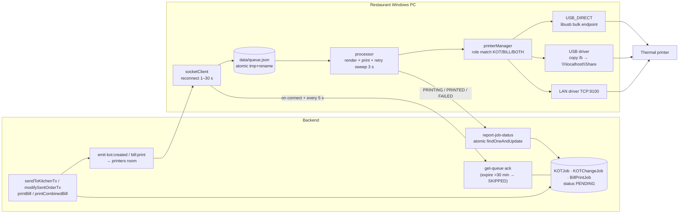
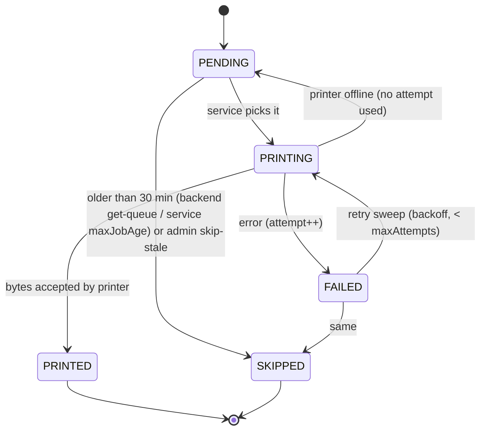

# 13 — Printing Architecture (Windows print-service)

Read-only investigation. No print job was executed, no printer contacted, no print-service file changed. Diagram: [`diagrams/12-printing-architecture.mmd`](diagrams/12-printing-architecture.mmd).

## 1. Three things to keep apart

| Thing | Where | Status |
|---|---|---|
| Existing Windows bridge `SohojPrintService.exe` | `print-service/` source; built copies in `print-service/release/`, `client-update-*`, `Admin_provider/` | IMPLEMENTED (High) |
| Android print prototype | — | **ABSENT** — no code anywhere in the repo |
| Proposed Android print agent | `docs/audit/zen-os-android-print-agent-*.md` | PROPOSED — see [20](20-android-printing-architecture.md) |

## 2. End-to-end flow

## 3. Job creation (backend)

| Job | Created by | Uniqueness | Trigger roles |
|---|---|---|---|
| KOTJob | `kotService.createKotJobForOrder` inside `sendToKitchenTx` transaction | unique `order` — one KOT ever per order; 11000 → returns existing | system timer, admin/manager/waiter/chef |
| KOTChangeJob | `kotService.createKotChangeJob` inside `modifySentOrderTx` | unique `{order, revision}`; printed as `jobType:"KOT"`, `priority: URGENT`, `changed:true` | admin/manager/waiter |
| BillPrintJob | `adminController.printBill`, `combinedBillService.printCombinedBill` | none per order (reprints); `requestKey` unique for combined | staff (`requireStaff`) |

Customers can never cause a physical print (all creators are staff-gated or server-internal). Confidence High.

## 4. Persistence and queue (print-service)

* `src/queue.js` — `Map<jobId, job>` mirrored to `data/queue.json` after **every** change via temp file + rename (atomic on NTFS for same volume in practice).
* `upsert` never regresses a locally PRINTED job; local print state wins over the backend's lagging copy; SKIPPED jobs re-listed by the backend come back as PENDING.
* `markWaiting` (printer offline) returns the job to PENDING **without** consuming an attempt; `markFailed` increments attempts; `maxAttempts` (env, default 10; processor default 5) → stays FAILED for a human.
* Single-instance lock (`src/instanceLock.js`, `tasklist`) prevents two services printing the same queue.

## 5. Communication

* Handshake `auth.printerKey` (from `.env PRINTER_KEY`); backend stores only SHA-256 (`printerDeviceService`). Device revocable (`status: Revoked`).
* Push: `kot:created`, `bill:print` in the printers room.
* Pull: `get-queue` ack on every (re)connect and every `QUEUE_POLL_INTERVAL_MS` (5 s) with `onlyNew` — covers missed pushes and multi-instance backends.
* Report: `report-job-status` per state change; backend increments attempts on PRINTING/FAILED, keeps SKIPPED unless PRINTED, updates `PrinterDevice.lastSeenAt/lastStatus`.
* REST alternative: `GET /api/admin/printer/queue` (staff) — also lists change slips; `PATCH /kot/:id/status` human override; `POST /skip-stale` admin.

## 6. Print status lifecycle

## 7. Routing, discovery, hardware

* **Routing:** by job type only — KOT → printer with role KOT else BOTH; BILL → BILL else BOTH (`printerManager.js:38-42`). **No** per-station/category/kitchen-section routing and no multi-printer fan-out (PARTIAL).
* **Discovery:** none automatic; printers declared in `printers.config.json` (`type` LAN/USB/USB_DIRECT, ip/port, `windowsPrinterName`/`windowsShareName`, `vendorId`/`productId`, `charsPerLine` 48 or 32). `PrinterDevice.lanIp` in the backend is informational only. Health check every 5 s per driver.
* **LAN:** raw TCP 9100. **USB (driver installed):** Windows share required, `copy /b`. **USB_DIRECT:** WinUSB device via `usb` 3.1 prebuilt binary (example config uses VID 0483 / PID 5720).
* The `printer` npm native addon is deliberately not used (`CLAUDE.md`).

## 8. Rendering

* `renderers/kotRenderer.js`, `billRenderer.js`, `layout.js` (column fitting to `charsPerLine`), ESC/POS via `node-thermal-printer`.
* Bill header from public profile (`src/restaurantProfile.js`, cached in `data/`), logo raster (`src/logo.js`, auto-invert), footer `BILL_FOOTER`.
* Scan-and-pay QR on **unpaid** bills: re-encodes the uploaded `paymentQr` (read with `jsqr`) or builds a UPI QR from `upiId` + total (`src/payQr.js`).
* **Bengali / non-Latin:** lines drawn by Windows GDI+ through PowerShell (`draw-text.ps1`, font "Nirmala UI"), cached as PNGs in `data/text-images/`, printed as raster; on failure prints `?` (never fails the job). Windows-only dependency.
* KOT shows items, add-on names (no prices), notes, table name/area, priority, customer name/phone (paper only).

## 9. Duplicate-print prevention (what is and isn't guaranteed)

| Scenario | Protection |
|---|---|
| Same order sent to kitchen twice | unique KOTJob per order + conditional status write |
| Socket redelivery / reconnect re-list | local queue keyed by backend `jobId`; PRINTED is terminal |
| Two services on one PC | instance lock |
| Two services on two PCs with the same or different keys | **not prevented** — both receive the printers room and both print (Medium) |
| Crash after printer accepted bytes but before `markPrinted` saved | job re-printed after restart (at-least-once; documented trade-off in `docs/audit`) |
| Double-click "Print bill" | creates two BillPrintJobs (no request key on single bill) — two copies print (Low) |

## 10. Failure recovery

PC off / service down → jobs persist in MongoDB; on reconnect `get-queue` recovers them, **but anything older than 30 min is SKIPPED automatically** (R-09). Printer off → jobs wait without burning attempts. Backend down → service keeps retrying socket with backoff up to 30 s; local queue intact. Report lost while disconnected → local state wins; next reconcile re-reports.

## 11. Readiness assessment

Strong for one restaurant with one PC: durable queue, idempotent jobs, reconcile on connect, tested (13 suites). Weak points: Windows-only (GDI+ text, share copy), single PC SPOF, no station routing, silent 30-min skip, leaked printer keys in git (R-01), no remote monitoring beyond `PrinterDevice.lastSeenAt`.
