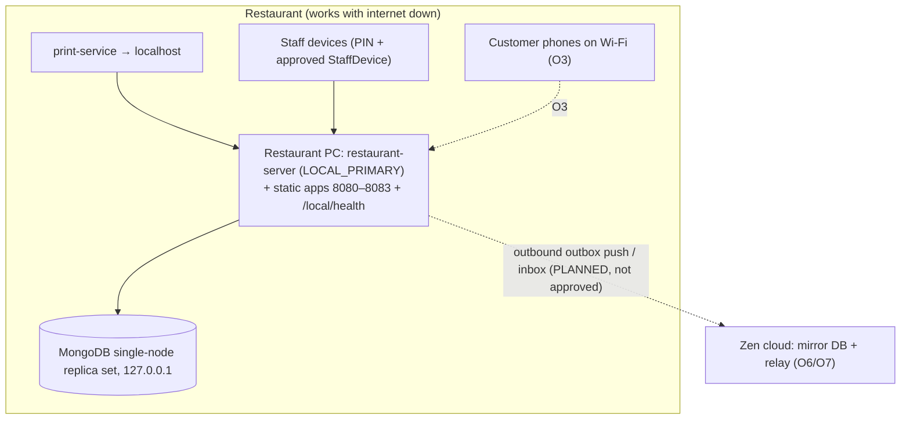

# 14 — Offline-First Architecture

Sources read: all of `docs/offline-edition/` (01–13, 18, 19), `config/deploymentMode.js`, `config/localModeCheck.js`, `config/localAuthModels.js`, `services/localAuthService.js` (exports), `local/*.js`, `server.js`, `middleware/authMiddleware.js`, `sockets/socket.js`, frontends' `src/offline/*` and `src/local/*`. Diagram: [`diagrams/13-offline-architecture.mmd`](diagrams/13-offline-architecture.mmd).

## 1. Two separate offline mechanisms exist

| Mechanism | What it is | Status |
|---|---|---|
| **Browser resilience cache** (admin, waiter, kitchen) | Last successful GET responses in IndexedDB `zen-saved-data`; banner shows "showing data saved at …"; **writes fail** | IMPLEMENTED (High) |
| **Offline Edition (LOCAL_PRIMARY)** | The same backend runs on a restaurant PC with a local MongoDB replica set and serves the apps over the LAN, so the internet is not needed at all | PARTIAL: O1 + O2 implemented (uncommitted); O3–O11 PLANNED |

There is **no** device-local database (RxDB, PouchDB, Dexie, SQLite) and **no** client write queue/outbox — rejected deliberately (doc 02 §1 option A; `savedData.js` header). ABSENT, High.

## 2. Target architecture (local-primary)

Principle: **one authoritative writer per restaurant**; cloud = read-only mirror + relay; never multi-master (doc 02, decision 1 approved).

## 3. Component status

| Component | Status | Evidence |
|---|---|---|
| Mode switch `DEPLOYMENT_MODE` (unset=CLOUD, LOCAL/LOCAL_PRIMARY, unknown=stop) | IMPLEMENTED | `config/deploymentMode.js` |
| Startup guard (loopback `mongodb://` + `replicaSet`, no sandbox JWT, no OTP echo, pepper ≥32 ≠ JWT, valid site id) | IMPLEMENTED | `config/localModeCheck.js` |
| Local DB = MongoDB replica set; init script | IMPLEMENTED | `scripts/localReplicaSet.js` |
| Local API = same Express app | IMPLEMENTED | `server.js` |
| LAN static hosting of 4 apps with generated `/config.js` (`localServer:true`) | IMPLEMENTED | `local/staticApps.js` |
| `/local/health` (LAN only) | IMPLEMENTED | `local/healthRoutes.js`, `lanOnly.js` |
| DNS override skipped offline | IMPLEMENTED | `server.js:11` |
| Offline auth: phone + PIN on admin-approved device, scrypt+pepper, lockout, append-only audit, sessions re-checked every request & socket, immediate revoke | IMPLEMENTED (O2) | `localAuthService.js`, `localAuthModels.js`, `authMiddleware.localTokenCheck`, `socket.js:106-115` |
| First-admin bootstrap (console code, loopback only) | IMPLEMENTED | `server.js:359-381`, `/api/local/setup/bootstrap` |
| OTP/Firebase staff login refused in LOCAL | IMPLEMENTED | `local/staffLoginGate.js` |
| Local authorization | IMPLEMENTED — same RBAC as cloud |  |
| LAN customer ordering (signed table tokens, LAN guest gate) | PLANNED O3 | doc 19 |
| Local media store (replace Cloudinary), bundled OCR data, degrade push/SMS/maps, hide PhonePe offline | PLANNED O4 | doc 07 |
| Local HTTPS (restaurant CA) | PLANNED O5 (strategy doc 12 approved) | doc 12 |
| Sync outbox/inbox, cloud ingest, relay | PLANNED O6/O7, **production sync not approved** | doc 05 |
| Offline rider claims | PLANNED O8 | doc 07 |
| Installer, Windows services, automated backup, pepper recovery | PLANNED O9 | doc 07, 11, 18 |
| GST invoice series per site | PLANNED O10 (deferred) | doc 13 |

## 4. Network detection and reconnection

* Browser: `connectivity.js` (navigator events + real request outcomes + `/api/health` probe every 10 s) → online / offline / unreachable.
* Socket.IO client default reconnection; print-service 1–30 s backoff then `get-queue` reconcile.
* Server: `getDB` cache drops a non-ready connection and reconnects on the next request; LOCAL boot keeps retrying (doc 10: DB-down-at-boot recovery tested).
* In LOCAL mode, internet loss changes nothing locally (no cloud dependency) — except components that call the internet: Firebase customer login, PhonePe, Twilio/MSG91, Cloudinary uploads, FCM, Google maps/routes, Tesseract data download. **No code currently detects internet loss to switch these off** (O4 planned).

## 5. Data consistency, idempotency, multi-device

Same guarantees as cloud because the writer is unchanged: atomic conditional writes, unique indexes, transactions on the local replica set. Multiple staff devices talk to the one PC, so no device-level conflicts. Order number counter is per database — restoring a backup rewinds it (doc 11 §5.1; doc 13).

## 6. Business requirement check — "offline: only waiter, admin, manager operations and bill printing"

| Requirement element | Today (cloud mode, internet down) | Offline Edition as designed |
|---|---|---|
| Waiter operations | ✗ fail (read-only cache only) | ✓ on LAN |
| Admin / manager operations | ✗ fail (read-only cache) | ✓ on LAN |
| Bill printing | ✗ (cloud creates jobs; PC can't reach cloud) | ✓ print-service → localhost |
| *Other* functions restricted | n/a | **Not restricted** — design keeps kitchen/KOT, inventory, customer Wi-Fi ordering (O3), on-site delivery |
| Mechanism to restrict | ABSENT | ABSENT (no feature flags keyed on connectivity; only O4's "PhonePe hidden / push skipped") |

Conclusion: the requirement is **not implemented** and **conflicts in scope** with the approved design (open question Q-01, decision D-12 in [24](24-architecture-decision-register.md)). Note that "bill printing only" without KOT printing would stop the kitchen's paper tickets offline — likely not intended; needs confirmation.

## 7. Automatic synchronization when internet returns

**Not implemented.** Designed in doc 05 (change-stream outbox → cloud push with `siteId:syncSeq` idempotency, inbox for remote orders/PhonePe relay/customer accounts/revocations, conflict register). See [15](15-data-synchronization-design.md). Until then a LOCAL restaurant's data stays only on the PC (plus manual `mongodump`).

## 8. Backup and recovery

LOCAL: manual `mongodump/mongorestore` runbook (doc 11 §5.1), keep `.env` (pepper) with backups; restore rewinds order numbers. Cloud: Atlas backups UNKNOWN. Automated backup PLANNED (O9).

## 9. Known limits (from docs 10, 18 + code)

Plain HTTP on LAN until O5 (PINs and tokens unencrypted on Wi-Fi); customer dine-in needs GPS (blocked on http) and login (needs internet) → customer ordering offline impossible until O3; Firebase Admin env required to boot; no data-import/cutover tool (needs approval); lost pepper = all PINs reset, no tool; waiter/kitchen have no self-service PIN change.

## 10. Offline readiness assessment

| Dimension | Score | Why |
|---|---|---|
| Staff operations offline (LOCAL) | Medium | works on LAN with PIN; HTTP only; no installer |
| Customer ordering offline | Low | blocked until O3 |
| Printing offline | High (LOCAL) | print-service unchanged against localhost |
| Sync / cloud visibility | None | O6/O7 not built or approved |
| Operational recovery | Low–Medium | manual backups, no reset tools |
| Cloud-mode outage behaviour | Low | read-only screens, no writes, no printing |
