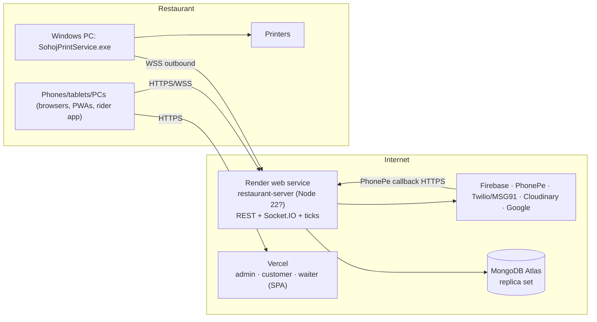

# 17 — Deployment and Infrastructure

Diagram: [`diagrams/16-deployment.mmd`](diagrams/16-deployment.mmd). Only evidence in the repository was used; hosting dashboards were not accessed. Domains are redacted.

## 1. Verified vs inferred

| Item | Evidence | Status / confidence |
|---|---|---|
| Backend on Render | `server.js:113-120` reads `RENDER_GIT_COMMIT`; docs mention Render health; `*.onrender.com` in config comments (per fact sheet) | Inferred, Medium |
| admin, customer, waiter on Vercel | `vercel.json` (SPA rewrite; customer adds cache headers) | Inferred, Medium-High |
| kitchen hosting | no `vercel.json` | UNKNOWN |
| MongoDB Atlas | `mongodb+srv` handling in `config/env.js` (`MONGO_DNS_SERVERS`), `deploymentMode.js` refuses `+srv` locally | Inferred, Medium |
| Atlas tier/backup/network access | — | UNKNOWN |
| Print-service on restaurant Windows PC | README, `Admin_provider/README.txt`, `.exe` builds | Verified (artifact), High |
| Offline Edition on restaurant PC | doc 11 manual setup; no installer | PARTIAL |
| Delivery app distribution | Gradle project; no release config/keystore in repo | UNKNOWN |
| CI/CD (GitHub Actions etc.) | no workflow files | ABSENT |
| Docker / IaC | none | ABSENT |
| Logging / monitoring / alerting | console only; no Sentry/APM | ABSENT |
| Backups | cloud UNKNOWN; local manual (doc 11) | — |

## 2. Topology (production, inferred)

Single backend instance assumed (in-process ticks, no socket adapter — running two instances would duplicate nothing harmful thanks to atomic writes, but live events would split).

## 3. Environment configuration (names only)

Backend: `PORT, NODE_ENV, CLIENT_URL, CUSTOMER_FRONTEND_URL, BRAND_NAME, MONGO_URI, JWT_SECRET, FIREBASE_PROJECT_ID, FIREBASE_CLIENT_EMAIL, FIREBASE_PRIVATE_KEY, CLOUDINARY_CLOUD_NAME, CLOUDINARY_API_KEY, CLOUDINARY_API_SECRET, TWILIO_ACCOUNT_SID, TWILIO_AUTH_TOKEN, TWILIO_PHONE, TWILIO_WHATSAPP_FROM, MSG91_AUTH_KEY, MSG91_SENDER_ID, MSG91_TEMPLATE_ID, PHONEPE_ENV, PHONEPE_MERCHANT_ID, PHONEPE_SALT_KEY, PHONEPE_SALT_INDEX, PUBLIC_API_URL, TZ, OTP_DEV_ECHO, MONGO_DNS_SERVERS, INVENTORY_V3_ENABLED, GOOGLE_ROUTES_API_KEY, DISABLE_BACKGROUND_JOBS` (+ Render's `RENDER_GIT_COMMIT`).
LOCAL extra: `DEPLOYMENT_MODE, LOCAL_PIN_PEPPER, LOCAL_SITE_ID, LOCAL_SESSION_HOURS, LOCAL_PORT_CUSTOMER|ADMIN|WAITER|KITCHEN, LOCAL_APPS_DIR`.
Frontends: `VITE_*` listed in [02 §2.2](02-repository-and-technology-inventory.md#22-web-frontends) plus runtime `public/config.js` (`window.__ZEN_CONFIG__`).
Print-service: `BACKEND_URL, PRINTER_KEY, QUEUE_FILE, MAX_ATTEMPTS, MAX_JOB_AGE_MINUTES, RETRY_BASE_DELAY_MS, RETRY_SWEEP_INTERVAL_MS, HEALTH_CHECK_INTERVAL_MS, USE_MOCK_PRINTER, QUEUE_POLL_INTERVAL_MS, PRINT_LOGO, LOGO_*, BILL_FOOTER, PRINT_PAY_QR, PAY_QR_SIZE, UNICODE_FONT`.
`.env.example` exists for server, kitchen, print-service; admin/customer/waiter have none in the repo (fact sheet §11).

## 4. Domain, DNS, CORS

Frontends and API on separate origins (Vercel / Render); CORS wildcard so any origin works. `server.js` forces DNS resolvers 1.1.1.1/8.8.8.8 in cloud mode (to resolve the Atlas SRV record), skipped in LOCAL. QR links built from `CUSTOMER_FRONTEND_URL` (`utils/qrLink.js`). PhonePe callback URL from `PUBLIC_API_URL`, redirect from `CLIENT_URL`.

## 5. Build pipeline

Manual / platform git-integration (UNKNOWN which branch auto-deploys). Correctness gates per `CLAUDE.md`: backend `node test/*.test.js`, frontends `npm run build`, print-service `npm test` — run by hand. Print-service release = `npm run build:exe` → copy folder/zip to the restaurant PC (currently also committed to git — anti-pattern).

## 6. Production vs development

`NODE_ENV=production` changes: OTP echo ignored, stack traces hidden, PhonePe env must be explicit, extra startup warnings. `scripts/localSandbox.js` = isolated dev backend (in-memory replica set, console OTP, dummy Firebase). `DISABLE_BACKGROUND_JOBS=true` for a second copy pointed at live data. No staging environment is defined in the repo (UNKNOWN).

## 7. Deployment risks
No CI; unknown deployed SHA (health endpoint can tell — use it); Render free/paid tier sleep behaviour UNKNOWN (a sleeping backend would delay KOTs); single instance; Atlas backups unverified; print-service updates are manual file copies.
