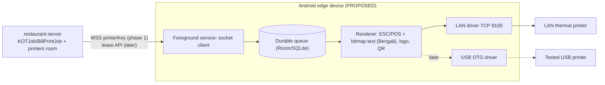

# 20 — Android Printing Architecture

**Status: PROPOSED (design-only). No Android printing code exists in this repository** (searched all source, `delivery-app/android` included; the rider app has no printer code). Sources: `docs/audit/zen-os-mobile-printing-executive-summary.md`, `…-feasibility-report.md`, `zen-os-android-print-agent-architecture.md`, `…-integration-contract.md`, `…-implementation-roadmap.md` (2026-10-28, branch `feature/inventory-v3`). Diagram: [`diagrams/18-android-printing.mmd`](diagrams/18-android-printing.mmd).

## 1. Classification

| Layer | Status |
|---|---|
| Existing Windows implementation | IMPLEMENTED — [13](13-printing-architecture.md) |
| Android prototype | ABSENT |
| Android print agent architecture, integration contract, roadmap | PROPOSED (written, not approved in any repo record) |

## 2. Proposed design (as documented)

* A **separate Android Print Agent** app on a **fixed restaurant edge device** (not a waiter's phone), foreground service, durable local queue, outbound authenticated socket to the backend.
* **LAN printers first** (raw TCP 9100, same as `lanDriver.js`); **USB OTG later**, only for tested models.
* **Phase 1 reuses the existing printer-device Socket.IO protocol unchanged** (printer key, `kot:created`, `bill:print`, `get-queue`, `report-job-status`); the Windows service stays in parallel.
* Later: per-agent enrollment, station assignment, and a **claim/lease protocol** so several agents don't print the same broadcast job (contract doc §6).
* Rendering must be re-implemented on Android (bitmap text for Bengali, logo, QR); Windows GDI+ path is not reusable.

## 3. Constraints and risks (from the docs, confirmed against current code)

* Broadcast semantics: every socket in the printers room receives every job → **two agents = double printing** today (no routing/lease in backend). Confirmed in `socket.js`.
* Android process death, Doze/battery optimisation, foreground-service policy; Wi-Fi quality; printer client isolation on guest Wi-Fi.
* At-least-once vs at-most-once when the app dies after the printer accepted bytes.
* Per-model physical certification (paper width, code pages, cut, raster).
* Key enrollment/rotation UX (and current leaked-key issue R-01 shows key handling needs care).
* Offline Edition interplay: an agent would need the LAN backend URL (local server) instead of the cloud.

## 4. Readiness

Not started. Prerequisites before code: decide single vs multi-agent (routing/lease), pick and certify printer models, approve backend contract changes (station routing, lease, agent version/health), define rollback to the Windows service.
