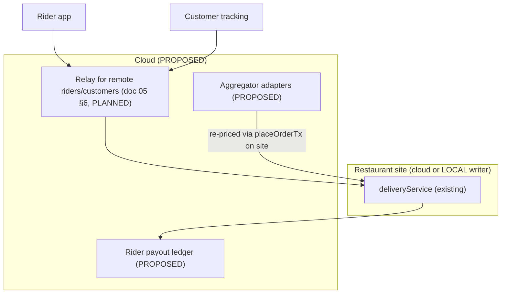

# 21 — Delivery Platform: Current and Proposed Architecture

Diagram: [`diagrams/19-delivery-proposed.mmd`](diagrams/19-delivery-proposed.mmd). Sources: `services/deliveryService.js`, `config/deliveryModels.js`, `utils/delivery*.js`, `services/deliveryRealtime.js`, `routes/deliveryRoutes.js`, `delivery-app/`, `docs/delivery/01–04`, `docs/offline-edition/05, 07`.

## 1. What exists today — IMPLEMENTED (branch `features/offline-edition`; not on `main`; production UNKNOWN)

| Capability | Implementation |
|---|---|
| Riders | `User.role = delivery`; created by admin/manager; employee OTP login; own socket user room only |
| Checkout | `orderType: ONLINE`, `deliveryAddress` within `deliveryRange`; COD default, Online (pay-first PhonePe) if enabled |
| Job creation | one `DeliveryJob` per order at CONFIRMED (hook + 5 s tick reconciliation) |
| Dispatch | broadcast offers per round (`offerTtlSeconds` 45, `maxRounds` 5) → escalate; admin assign/unassign/rebroadcast/cancel |
| Accept | single transaction: offer SENT→WON, capacity `$inc` guarded `activeCount < capacity`, job SEARCHING→ASSIGNED, `capVersion` bump |
| Pickup / drop | pickup needs order READY; OTP drop (attempt-limited, `otpCode` select:false) → order READY→DELIVERED (role delivery) in same transaction |
| COD | `CodCollection` custody record (amount = order.total); admin verify → `settleBills` → PAID/SETTLED/COMPLETED; dispute path |
| Tracking | signed revocable token, `/track/:token` page, `track` socket room; no OTP/phones in payload |
| GPS | stored only while rider has active job, TTL 7 days; rate-limited posts |
| Routes | Google Routes API optional; never invented ETA |
| Admin | board, partners, live map, COD cash, reports, settings |
| Rider app | React Native + Kotlin foreground location service, Keystore session, FCM (config needed) |
| Tests | unit, flow, replica-set race tests, HTTP+socket e2e (per `docs/delivery/04-…`, 2026-11-20) |

## 2. Gaps (verified or documented)

* FCM requires `google-services.json` (not in repo); background GPS behaviour unverified on devices.
* Riders outside the restaurant LAN cannot use a LOCAL_PRIMARY site (needs cloud relay, O7).
* No third-party aggregator integration (Swiggy/Zomato/ONDC) — ABSENT.
* **No delivery fee or packing charge is charged.** `RestaurantProfile` has `deliveryBaseFee`, `deliveryFeePerKm`, `freeDeliveryAbove`, `packingCharge`, but no service, util or controller reads them (grep, High). They are configuration-only today.
* No rider payouts/settlement ledger beyond COD custody.

## 3. Future delivery platform — **PROPOSED** (this package's suggestion, not an approved plan)

Principles to keep if extended: the site remains the single writer; orders from any channel are re-priced by `placeOrderTx`; a rider never marks PAID; offline rider actions are **claims** validated on reconnect (doc 07 O8); one job per order; atomic accept.
