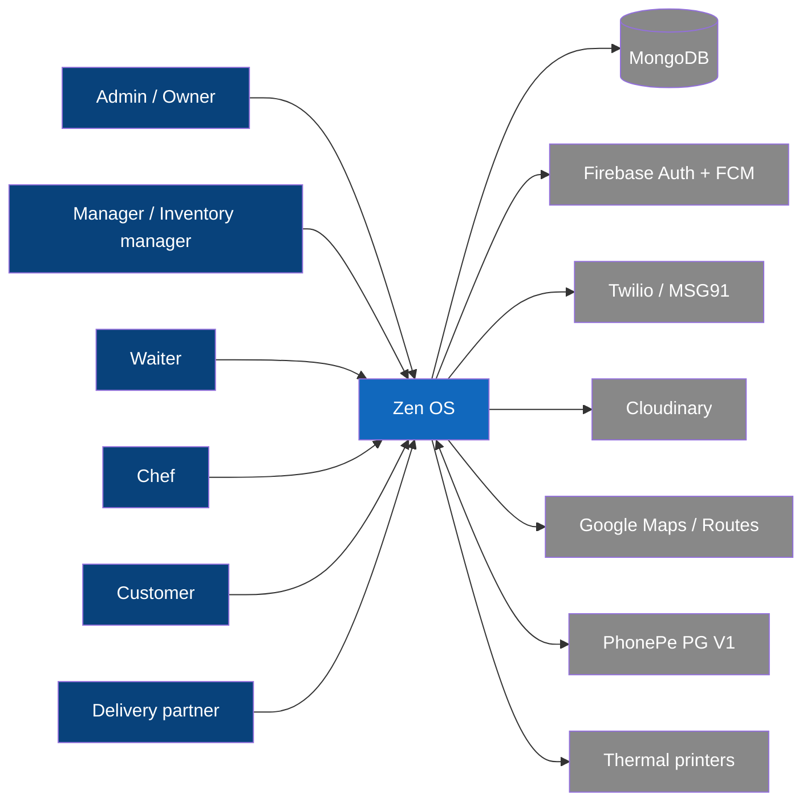
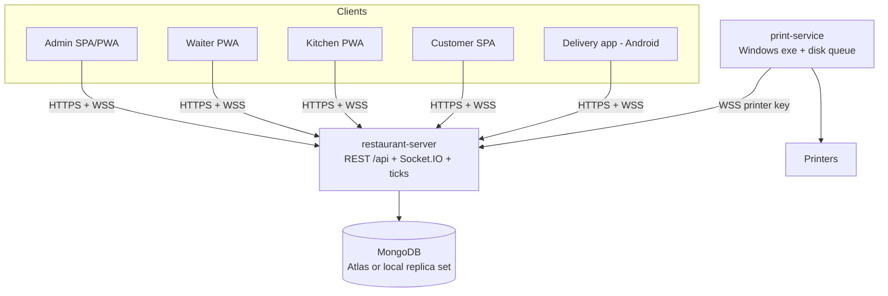
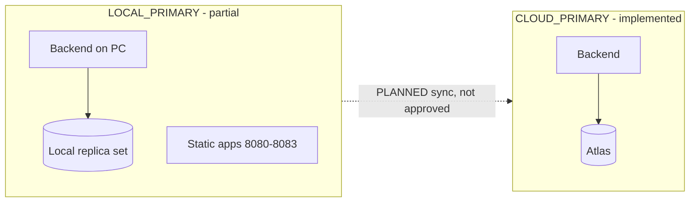

# 03 — High-Level System Architecture

## 1. Architectural style (verified)

* **Server-authoritative modular monolith**: one Node.js backend (`restaurant-server`) holding all business rules, one MongoDB database, thin clients.
* **Event push** over Socket.IO with role-scoped rooms; clients refetch on events.
* **Edge print bridge** on-premises, pulling and receiving jobs over an outbound socket.
* **Two deployment shapes** of the same backend: CLOUD_PRIMARY (production) and LOCAL_PRIMARY (Offline Edition, partial).

## 2. System context

## 3. Containers (verified)

## 4. Deployment shapes

| Shape | Writer | Status |
|---|---|---|
| CLOUD_PRIMARY | cloud backend (Render, inferred) + Atlas | IMPLEMENTED (production) |
| LOCAL_PRIMARY | restaurant PC backend + local replica set + LAN app hosting | PARTIAL: O1/O2 implemented, uncommitted |
| LOCAL_PRIMARY + cloud mirror/relay | PC writer, cloud read-only mirror | PLANNED, not approved |

## 5. Quality attributes and how the architecture meets them

| Attribute | Mechanism | Status |
|---|---|---|
| Correctness under concurrency | atomic conditional updates, unique indexes, transactions, optimistic revision | IMPLEMENTED |
| Exactly-once KOT | unique KOT per order + durable bridge queue keyed by job id | IMPLEMENTED |
| Data protection | role rooms, PII-stripped kitchen payloads, select:false secrets | IMPLEMENTED (exceptions R-02, R-04) |
| Availability (internet outage) | Offline Edition | PARTIAL |
| Scalability | single instance; sufficient for ~200 orders/day | IMPLEMENTED (not horizontally scalable — R-11) |
| Operability | console logs, `/api/health`, `/local/health` | PARTIAL |

## 6. Key cross-cutting rules

Server authority (rule 2), state machine (rule 4), idempotent jobs (rule 5), canonical enums (no hard-coded status strings), one writer per database, verified-only payments.
