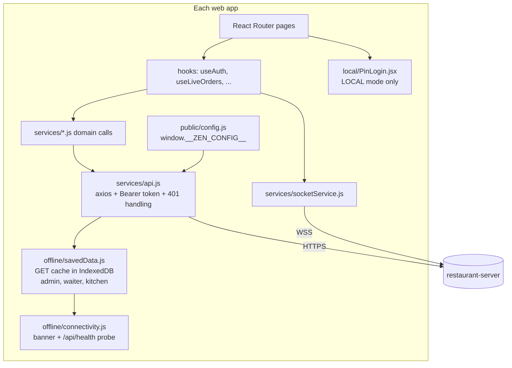
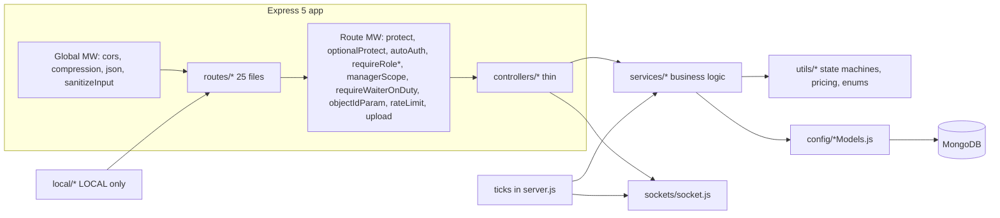
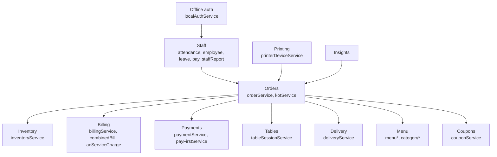

# 04 — Frontend and Backend Architecture

Detail inventories: earlier `../05-application-architecture.md` and `../06-backend-architecture.md` (valid except corrections listed in [README](README.md)).

## 1. Frontend architecture (verified)

### 1.1 Common structure of the four web apps

| Concern | Decision | Evidence |
|---|---|---|
| State | React context + hooks; no global store | `CLAUDE.md`; `src/context/*` |
| Auth token | `localStorage` | `services/api.js` |
| Live data | socket event → debounced refetch (`ORDER_EVENTS` in admin & waiter) | `hooks/useLiveOrders.js:7-30` |
| Runtime config | `public/config.js` overrides `VITE_API_URL` without rebuild | `config/runtimeConfig.js` |
| PWA | `vite-plugin-pwa` in admin/waiter/kitchen | `pwa/registerPwa.js` |
| i18n | English + Bengali | `src/i18n/` |

### 1.2 Per-app responsibilities

| App | Pages / modules | Roles |
|---|---|---|
| admin (React 19) | Dashboard, Orders, Invoices (day close, dues, xlsx), Tables, Menu, Inventory (+V3, inventory-manager view), Employees, Coupons, Offers, Insights, Delivery, Devices (LOCAL), Users, Profile, Help, `/kitchen` display, `/setup` (LOCAL) | admin, manager (filtered), inventory_manager (inventory only) |
| waiter | Tables, Orders, New order, Order detail, Activity, Profile | waiter (+ admin/manager can log in) |
| kitchen | Board, Profile | chef, admin |
| customer | Home, Menu, Cart, Orders, Order detail, Offers, Favorites, Notifications, Profile, Help, Contact, Policy pages, Track | customer / public |
| delivery-app (RN) | Login, Home, Offer overlay, Deliveries, Job detail, History, Profile | delivery |

## 2. Backend architecture (verified)

| Layer | Responsibility | Rule |
|---|---|---|
| routes | URL → middleware chain | RBAC always at route level |
| controllers | parse request, call service, map `err.statusCode` | no business logic (some exceptions: `printBill`, profile inline handler) |
| services | business rules, transactions, side effects returned or emitted | "pure-ish, take `{ models, ... }`" |
| utils | enums, state machines, pricing, parsing | single source for every status string |
| models | schemas, indexes, append-only hooks | four model modules |
| sockets | handshake, rooms, typed emitters | emits never fail a request |
| ticks | offers, auto-send, pay-first, delivery, category reset | atomic, multi-instance safe |

### Domain module map

## 3. Proposed improvements (PROPOSED)

| Item | Why |
|---|---|
| Shared enum/label package consumed by all apps | rename drift (`CLAUDE.md` gotcha) |
| Move bill payload building into a service | thin-controller rule |
| Align admin and other apps on one React/Vite major version | maintenance |
| Remove server-only deps from admin `package.json` | hygiene |
