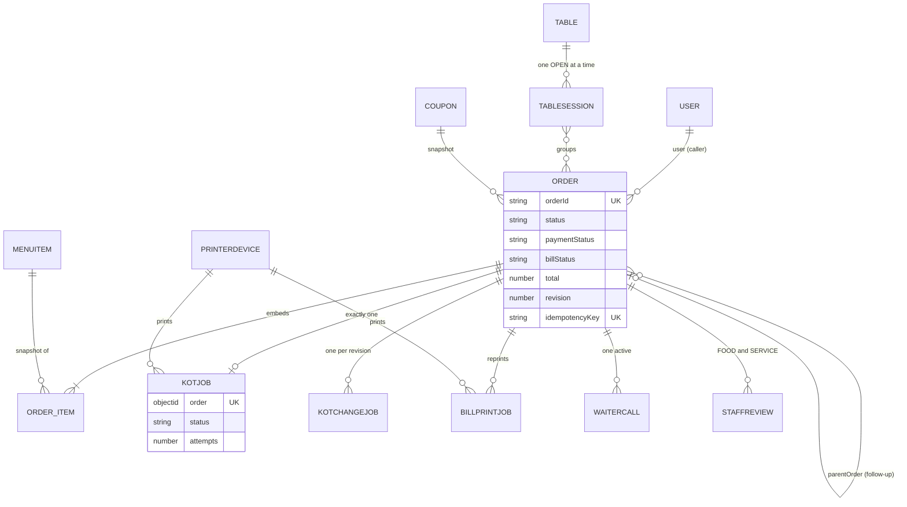
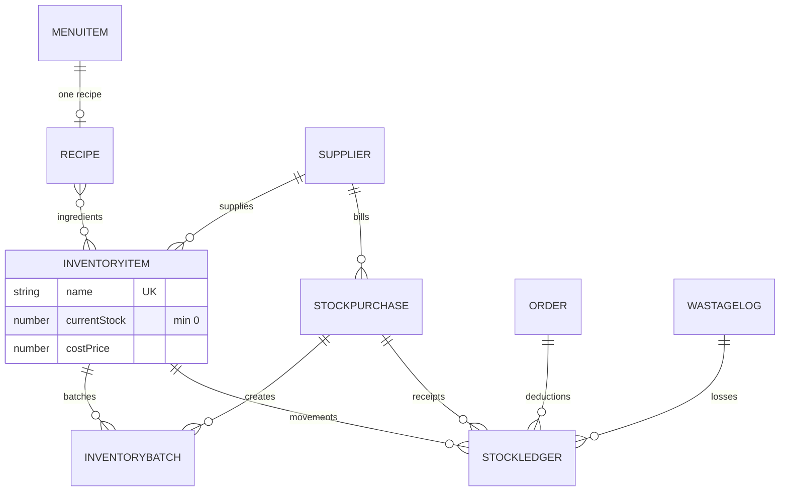
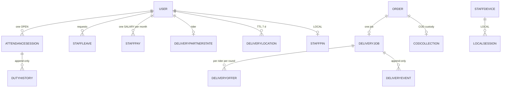

# 05 — Database Architecture and ERD

Field-level dictionary: earlier `../07-database-dictionary.md` (verified, still valid). DBML: earlier `../diagrams/schema.dbml`.

## 1. Architecture

| Aspect | Design | Status |
|---|---|---|
| Engine | MongoDB; Atlas in cloud, single-node replica set 7.x on restaurant PC | IMPLEMENTED |
| Topology | one database per restaurant; tenant key = DB name | IMPLEMENTED |
| Access | Mongoose 9, models bound per connection (`getModels(conn)`) | IMPLEMENTED |
| Transactions | kitchen send, edits after KOT, cancel with stock reversal, delivery accept/drop, menu time/category ops, some inventory | IMPLEMENTED (replica set required) |
| Integrity | unique / partial unique indexes as business rules; atomic conditional updates | IMPLEMENTED |
| Audit | `statusHistory`, actor snapshots, append-only DutyHistory/DeliveryEvent/LocalAuthEvent, StockLedger | IMPLEMENTED |
| Deletion | hard delete only; no soft delete | IMPLEMENTED (risk) |
| Migrations | additive schema + read-time fallbacks; one-off scripts | IMPLEMENTED (no framework) |
| Retention | TTL: DeliveryLocation 7 d, LOCAL pending devices 24 h, sessions purge 30 d, rate limits | IMPLEMENTED |

## 2. Collection groups (55)

| Group | Collections |
|---|---|
| Identity & config (4) | User, RestaurantProfile, Counter, PrinterDevice |
| Menu (4) | Category, MenuTime, MenuItem, Chef (legacy) |
| Orders & floor (9) | Order, Table, TableSession, KOTJob, KOTChangeJob, BillPrintJob, Invoice (legacy), WaitlistEntry, WaiterCall |
| Engagement (4) | Coupon, NotificationLog, SupportTicket, StaffReview |
| People (4) | AttendanceSession, DutyHistory, StaffLeave, StaffPay |
| Inventory v2 (7) | Supplier, InventoryItem, InventoryBatch, Recipe, StockPurchase, StockLedger, WastageLog |
| Delivery (6) | DeliveryPartnerState, DeliveryJob, DeliveryOffer, DeliveryLocation, DeliveryEvent, CodCollection |
| Inventory V3 (12) | Settings, ItemV3Config, SupplierV3Config, FinancialEntry, RecurringRule, CostSchedule, CountSession, BookExpectation, BookConfirmation, LossClassification, V3Operation, V3Audit |
| LOCAL auth (6) | StaffDevice, StaffPin, LocalSession, LocalRateLimit, LocalAuthEvent, LocalSetupState |

## 3. ERD — orders, floor and printing

## 4. ERD — inventory

## 5. ERD — people and delivery

## 6. Data ownership (single writer per field group)

| Data | Writer(s) |
|---|---|
| Order status | `orderService`, `billingService` (completion), `deliveryService` (rider drop) |
| Order payment | `adminController.updateOrderPayment`, `billingService`, `combinedBillService`, `paymentService` — all guarded by `paymentStatus: {$ne: PAID}` |
| Stock | `inventoryService`, `inventoryV3Operations` |
| Print job status | printer socket, manual override, stale expiry |
| Table occupancy | `tableSessionService` |

## 7. Known data risks and proposed fixes

| Risk | Proposed fix (PROPOSED) |
|---|---|
| Table session opened outside the order insert transaction | wrap in one transaction |
| Hard deletes of referenced users/items/tables | soft-delete flag or block when referenced |
| Missing indexes: `Order.user`, `{status, autoPrepareAt}`, `{status, paymentDeadline}`, KOT/Bill `{status, createdAt}` | add |
| `RestaurantProfile` not enforced singleton | fixed `_id` |
| Inventory V3 unique indexes depend on setup script | verify script ran in each environment |
| `Invoice` legacy enums | retire or align (decision) |
