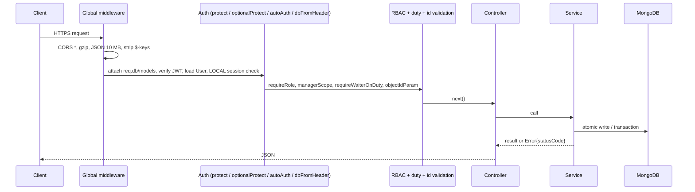
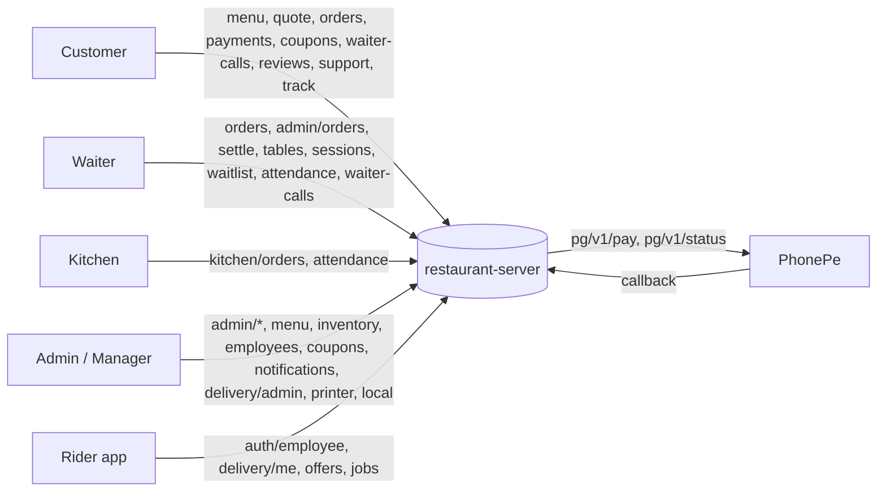

# 06 — API Architecture

Route inventory (corrected): earlier `../09-api-architecture.md` plus the 15 Offline Edition handlers below.

## 1. Conventions (verified)

| Aspect | Implementation |
|---|---|
| Style | JSON REST under `/api`, no version prefix, no OpenAPI spec |
| Auth | `Authorization: Bearer <JWT>`; guest order access `x-guest-order-token`; PhonePe callback `X-VERIFY`; print bridge uses sockets |
| Errors | `{ message, code? }`; codes `SESSION_EXPIRED`, `ACCOUNT_INACTIVE`, `USE_PIN_LOGIN`, `RATE_LIMITED`; status from `err.statusCode` else 500 (unknown routes also 500 — R-14) |
| Concurrency | `revision` (409), conditional writes (409 "changed by someone else") |
| Idempotency | `idempotencyKey` (orders), `requestKey` (combined bill, V3 operations), unique indexes |
| Size | 276 handlers / 25 route files + 2 in `server.js` |

## 2. Request pipeline

## 3. Route groups and access

| Group | Handlers | Access pattern |
|---|---|---|
| `/api/auth` | 15 | public login steps; protect for preferences; OTP/Firebase staff routes blocked in LOCAL |
| `/api/orders` | 9 | optionalProtect + duty for place/edit/cancel; staff for confirm/approve/reject |
| `/api/admin` | 25 | staff / management / admin |
| `/api/menu`, `/api/categories` | 18 + 7 | public reads; management writes; staff availability |
| `/api/payments` | 3 | initiate optionalProtect; status autoAuth; callback public + checksum |
| `/api/admin/tables`, `/table-sessions`, `/waitlist` | 7 + 3 + 5 | public table read/validate; staff/management |
| `/api/admin/inventory`, `/inventory/v3` | 28 + 24 | inventory roles; V3 behind `requireV3` |
| `/api/admin/employees`, `/api/attendance` | 25 + 7 | self-service `/me`; management + manager scope |
| `/api/kitchen` | 2 | admin, chef |
| `/api/admin/printer` | 7 | staff; device admin |
| `/api/admin/restaurant` | 6 | public profile; admin writes |
| `/api/coupons`, `/api/notifications` | 8 + 7 | public/optional; admin |
| `/api/waiter-calls`, `/api/reviews`, `/api/support` | 7 + 2 + 2 | customer/guest + staff |
| `/api/delivery` | 36 | rider (rate-limited), management `/admin`, public `/track/:token` |
| `/api/invoices`, `/api/admin/chefs` | 3 + 5 | staff; legacy chefs admin |
| `/api/local` (LOCAL only, LAN only) | 15 | see §4 |

## 4. Offline Edition API (LOCAL only — `routes/localAuthRoutes.js:35-53`)

| Method & path | Guard |
|---|---|
| GET `/setup/status`, POST `/setup/bootstrap` | LAN; bootstrap loopback only |
| POST `/devices/register`, `/devices/status` | LAN, public |
| GET `/devices`; POST `/devices/:id/approve|reject|revoke` | management |
| POST `/auth/login` | LAN, public |
| GET `/auth/session`; POST `/auth/logout`, `/auth/change-pin` | any PIN role |
| GET `/auth/events` | admin |
| GET `/staff/pins`; PUT `/staff/:userId/pin` | management |

## 5. Communication map

## 6. Proposed API improvements (PROPOSED)

OpenAPI spec generated from routes; `/api/v1` prefix for new endpoints; consistent 404; CORS allow-list; rate limits on auth/order/payment; request ids; `requestKey` on single bill print; remove `/api/test-whatsapp/:phone`; contract tests per app.
