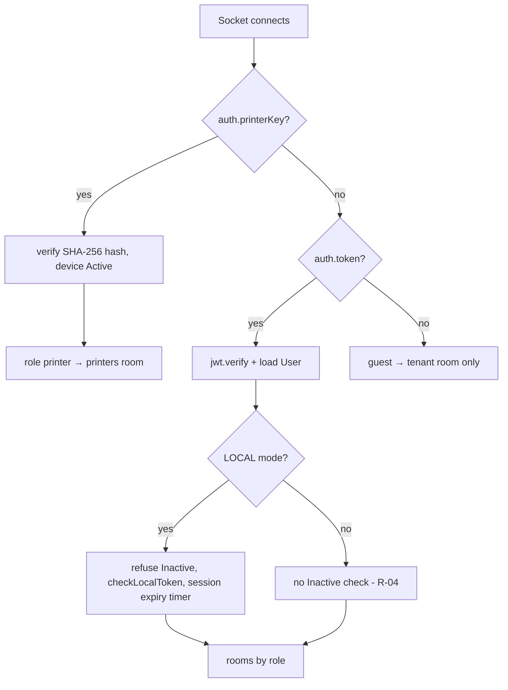
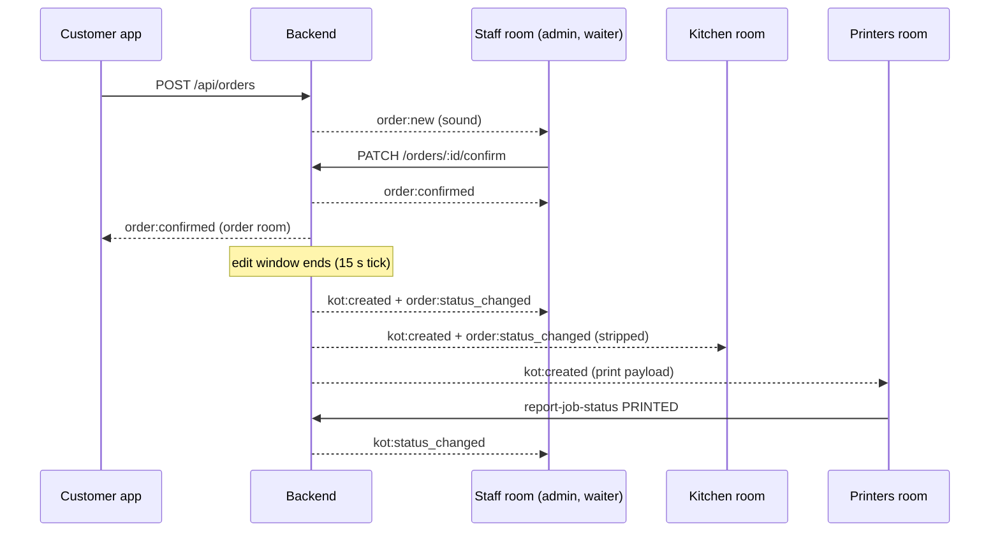

# 07 — Socket.IO Architecture

Source: `restaurant-server/sockets/socket.js`, `utils/tenantKey.js`, `services/deliveryRealtime.js`; consumers verified by string search across all clients (discovery §7).

## 1. Handshake

## 2. Rooms

| Room | Members | Payload class |
|---|---|---|
| `tenant:{key}` | every socket, incl. anonymous | `menu:updated` — **and legacy full-order events (R-02)** |
| `…:staff` | admin, manager, waiter | full orders, payments, PII, print/attendance/waitlist/inventory |
| `…:kitchen` | chef only | PII-stripped orders and KOTs |
| `…:printers` | print bridges (+ staff on request) | print payloads (paper-only customer name/phone) |
| `…:order:{id}` | owner, guest token holder, staff | one order |
| `…:user:{id}` | staff and riders, own id | call-waiter rings; rider offers/jobs |
| `…:delivery-admin` | admin, manager | rider GPS, board |
| `…:track:{jobId}` | tracking-token holder | status + rider position |

## 3. Event catalogue (verified consumers)

| Event | Rooms | Consumers |
|---|---|---|
| `order:new` | staff | admin, waiter |
| `order:confirmed`, `order:status_changed`, `order:cancelled`, `order:payment_changed`, `order:needs_attention` | staff, order, kitchen (stripped: status_changed, cancelled) | admin, waiter (`ORDER_EVENTS`), customer, kitchen |
| `table:cleared`, `table:freed`, `waitlist:updated` | staff | admin, waiter |
| `kot:created` | staff (full), kitchen (stripped), printers (payload) | admin, kitchen, print-service |
| `bill:print` | staff, printers | print-service |
| `kot:status_changed`, `bill:status_changed`, `inventory:alert`, `waiter_call:activity` | staff | admin notification panel |
| `employee:attendance:updated` | staff | admin, waiter |
| `menu:updated` | tenant | admin, waiter, customer |
| `waiter_call:new/updated` | user rooms; order room | waiter, customer |
| `delivery:*` (12 events) | user, delivery-admin, track, order | delivery-app, admin, customer |
| `auth:session_ended` | revoked socket | LOCAL apps |
| **Legacy** `new-order`, `order-status-updated`, `order-rejected` (tenant), `order-approval-request`, `kot-print`, `bill-print` (staff) | — | **none** (remove — PROPOSED) |

Client → server: `join-order`, `join-tracking` (ack), `employee:attendance:heartbeat`, `register-printer`, `get-queue` (ack), `report-job-status`.

## 4. Event flow — new customer order to kitchen

## 5. Reliability characteristics

Fire-and-forget emits after commit; clients refetch on events and on reconnect; print bridge reconciles by `get-queue`; no server replay; single process (no Redis adapter).

## 6. Proposed changes (PROPOSED)

1. Delete legacy emits (fixes R-02).
2. Refuse `Inactive` users at handshake in cloud mode and disconnect on deactivation (R-04).
3. Restrict socket CORS to known origins.
4. If more than one backend instance is ever needed: Redis adapter.
5. Decide whether admin should join the kitchen room (docs say yes, code says no) and update `CLAUDE.md` either way.
