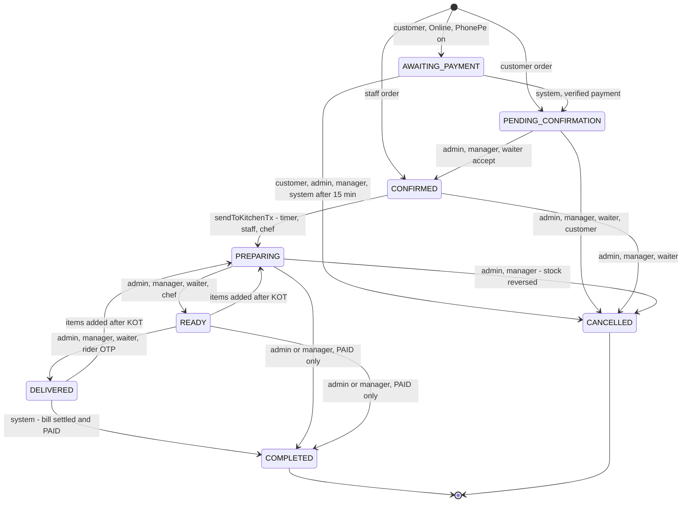
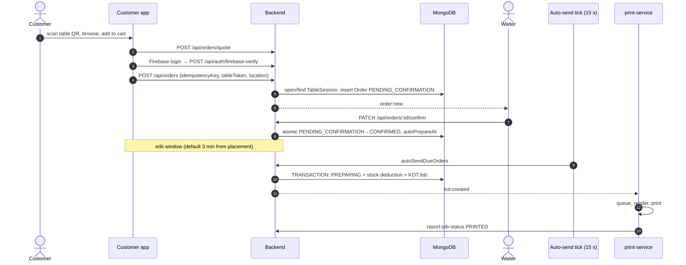
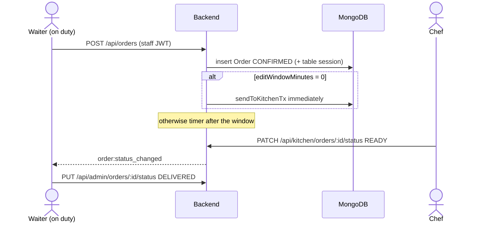
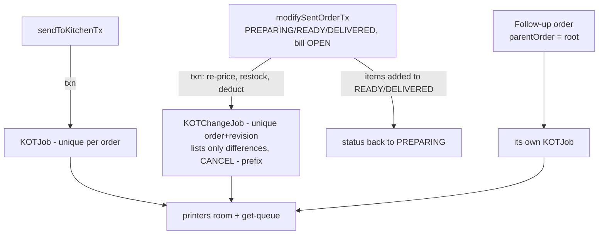
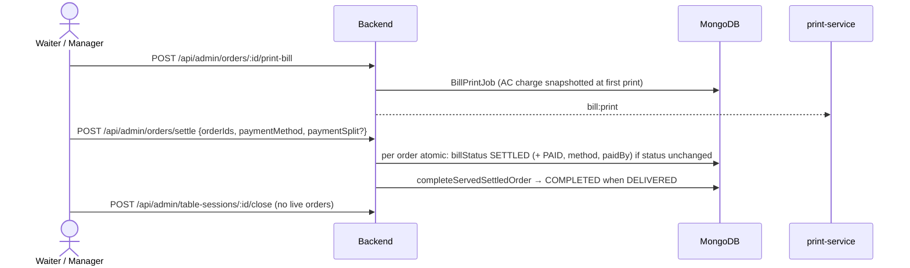

# 08 — Order and KOT Workflow

All IMPLEMENTED unless labelled. Source: `services/orderService.js`, `kotService.js`, `billingService.js`, `utils/orderStateMachine.js`.

## 1. Order state machine

Admin may additionally force any status as a pure flag change (no stock/KOT side effects).

## 2. End-to-end sequence — customer QR order, dine-in

## 3. Staff order and kitchen

## 4. KOT lifecycle and change slips

## 5. Billing and completion

## 6. Failure handling

| Failure | Behaviour |
|---|---|
| Duplicate submit | same order returned (idempotency key) |
| Two staff accept at once | second gets 409 |
| Stock runs out before kitchen send | order parked with `sendError`, `order:needs_attention` |
| Concurrent edit | 409 on revision mismatch |
| Settle while someone changes the order | that order rejected "changed by someone else" |
| Printer down | KOT waits; skipped after 30 min (staff alert PROPOSED) |
| Paid online then cancelled | no refund (PLANNED) — manual |
| Order insert fails after session opened | table may stay occupied (R-10; fix PROPOSED) |

## 7. Open item
OD-2: whether customers may order without login. Guest ordering on the restaurant LAN is PLANNED (O3, signed table tokens).
