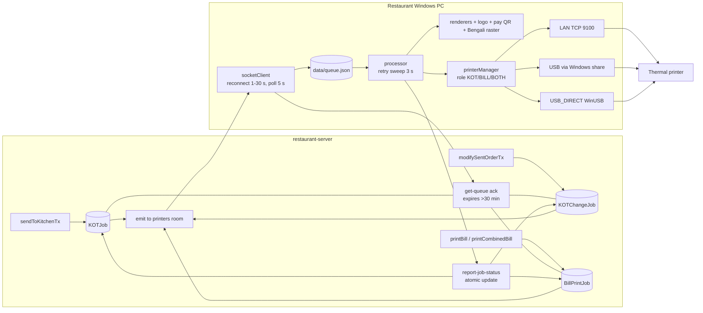
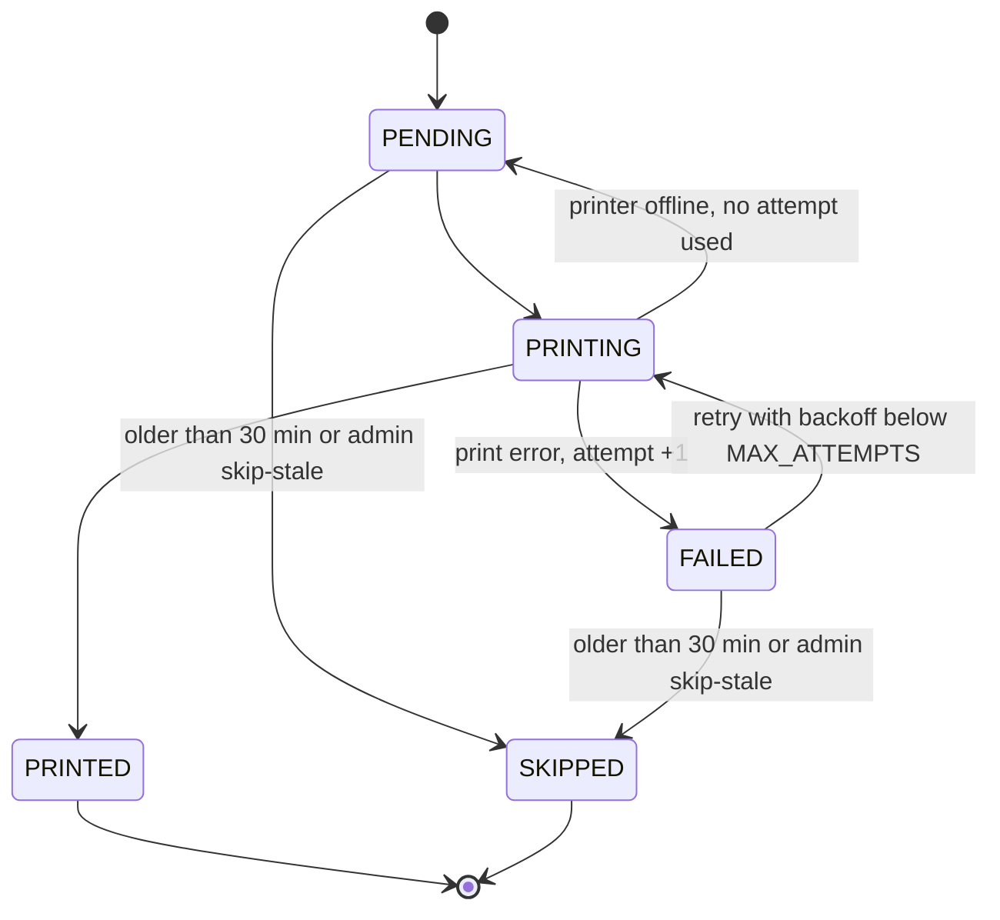
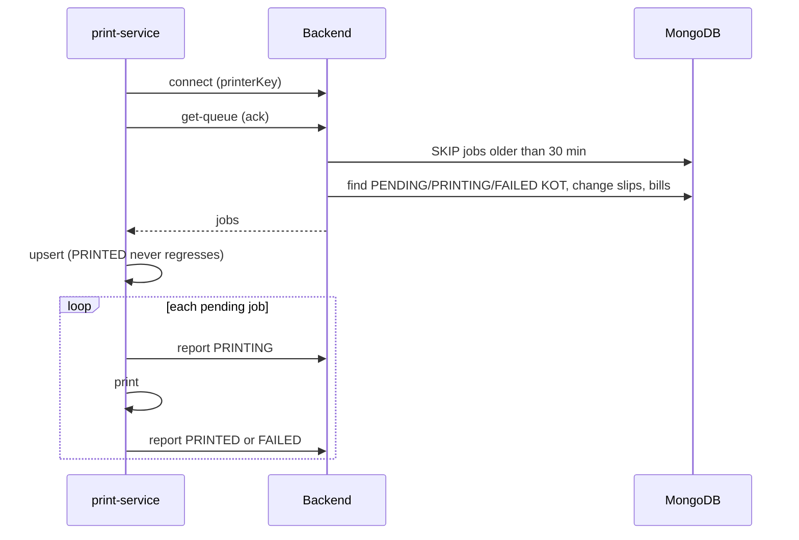
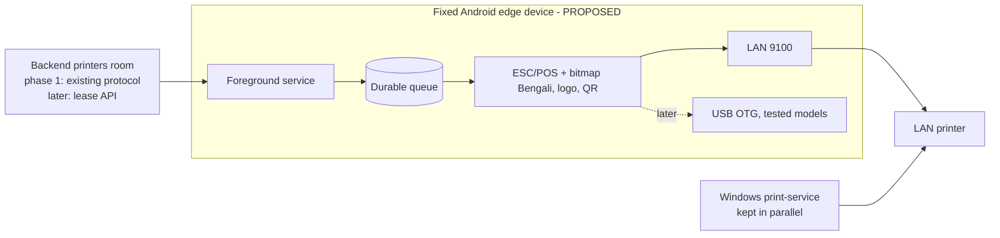

# 09 — Printing Architecture

Three distinct things: **Windows print-service** (IMPLEMENTED), **Android prototype** (ABSENT — no code), **Android print agent** (PROPOSED, `docs/audit/*`). Earlier detail: `../13-printing-architecture.md`, `../20-android-printing-architecture.md`.

## 1. Current architecture (IMPLEMENTED)

## 2. Job status lifecycle

## 3. Guarantees

| Guarantee | Mechanism | Holds? |
|---|---|---|
| One KOT per order | unique index + conditional status write in transaction | Yes |
| No reprint after PRINTED (same bridge) | local queue keyed by backend job id; PRINTED terminal | Yes |
| No lost job across restarts | MongoDB jobs + disk queue + reconcile | Yes, **unless older than 30 min** |
| Single bridge per PC | instance lock | Yes |
| No double print across two bridges | — | **No** (broadcast room) |
| At-most-once if crash after printer accepted bytes | — | No (at-least-once) |
| Bill double-click | — | No (no request key on single bill) |

## 4. Sequence — reconnect recovery

## 5. Gaps and proposed changes (PROPOSED)

| Gap | Proposal |
|---|---|
| Silent 30-min skip | staff alert + configurable window |
| Role-only routing | station/category routing on `PrinterDevice` + job assignment |
| Two bridges double-print | job lease (claim/lease protocol from `docs/audit/…integration-contract.md` §6) |
| Leaked keys in git (R-01) | rotate; stop committing builds |
| Windows-only Bengali | Android renderer must re-implement |
| No remote monitoring | alert when `PrinterDevice.lastSeenAt` stale |

## 6. Android print agent (PROPOSED)

Prerequisites: OD-7 approval, certified printer models, single-agent first, lease protocol before multi-agent, LAN backend URL support for Offline Edition.
