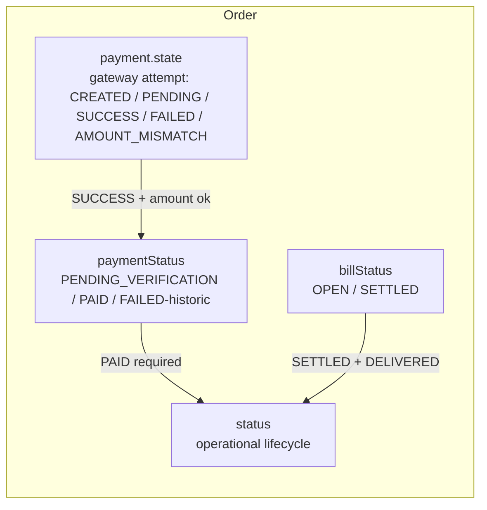
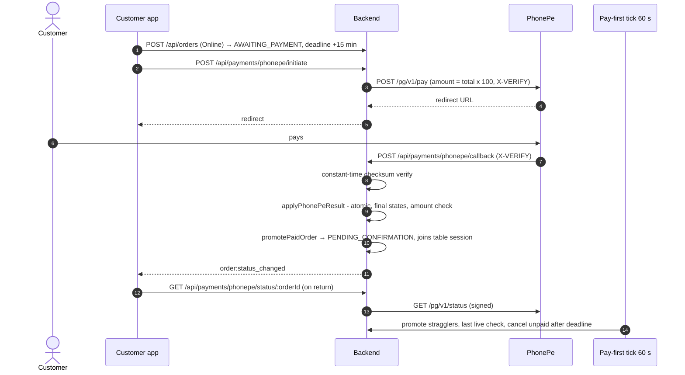
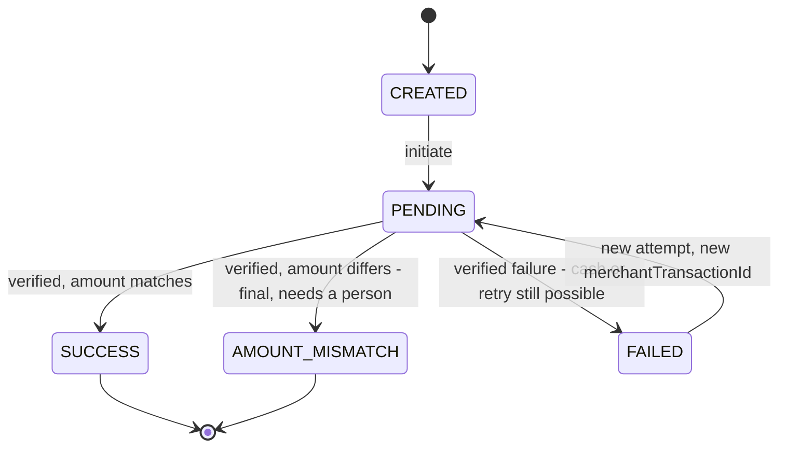
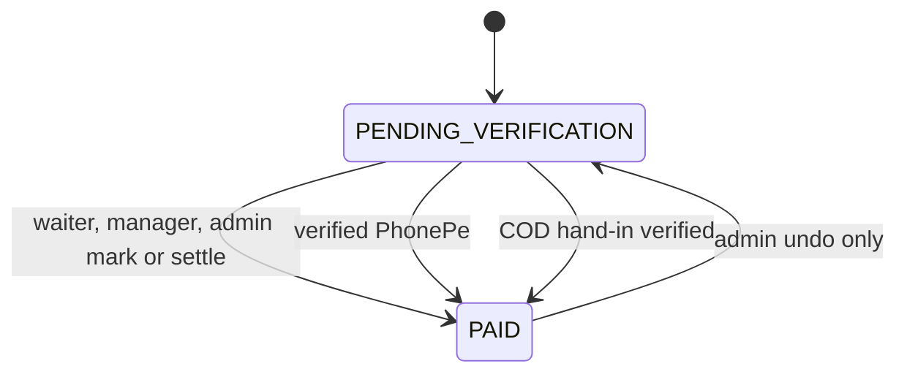
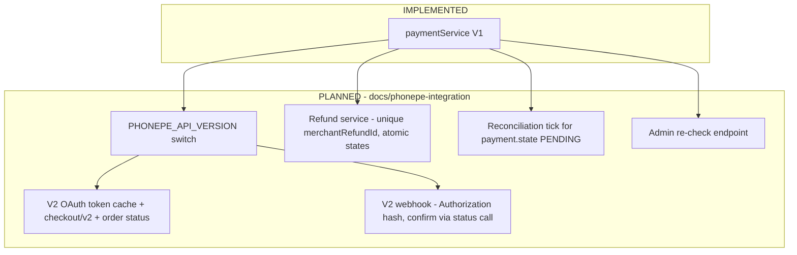

# 10 — Payment Architecture

Sources: `services/paymentService.js`, `payFirstService.js`, `billingService.js`, `combinedBillService.js`, `utils/paymentMode.js`, `utils/phonePeEnv.js` (uncommitted), `docs/phonepe-integration/*`.

## 1. Payment methods

| Method | Who records it | Proof | Status |
|---|---|---|---|
| Cash | staff (settle / mark paid) | staff action | IMPLEMENTED |
| UPI deep link / static QR on bill | staff | staff action (link is never proof) | IMPLEMENTED |
| Split `Both` (cash + online) | staff, one bill | amounts must sum to total | IMPLEMENTED |
| PhonePe PG V1 | system | checksum-verified result + amount match | IMPLEMENTED |
| COD (delivery) | rider custody → management verifies | management action | IMPLEMENTED (branch) |
| PhonePe V2 | — | — | PLANNED (OD-5) |
| Refunds | — | — | PLANNED (G10) |

## 2. Three separate state fields on an order

## 3. PhonePe pay-first sequence

## 4. Gateway attempt state

## 5. Staff payment and settlement

## 6. Security controls (IMPLEMENTED)

Server-derived amount; redirect never trusted; callback authenticated only by `X-VERIFY` with `timingSafeEqual`; amount re-asserted in the update filter; SUCCESS/AMOUNT_MISMATCH final; unknown `PHONEPE_ENV` disables the gateway; salt key only in backend `.env`; public profile exposes only `phonePeEnabled`; `paidBy/paidAt` written only with the PAID flip.

## 7. Gaps and proposed architecture (PLANNED / PROPOSED)

| Gap | Impact | Proposal |
|---|---|---|
| No refunds | paid-then-cancelled online orders need manual refund | refund service + admin alert (PLANNED G10) |
| Attempt overwritten per retry | weak audit trail | append attempts to a `PaymentAttempt` collection (PROPOSED) |
| Reconciliation only for AWAITING_PAYMENT | late success on other orders may be missed | G8 |
| Delivery/packing charges unused | revenue not charged | OD-6 |
| Offline: PhonePe unreachable | must be hidden offline | O4 PLANNED |
