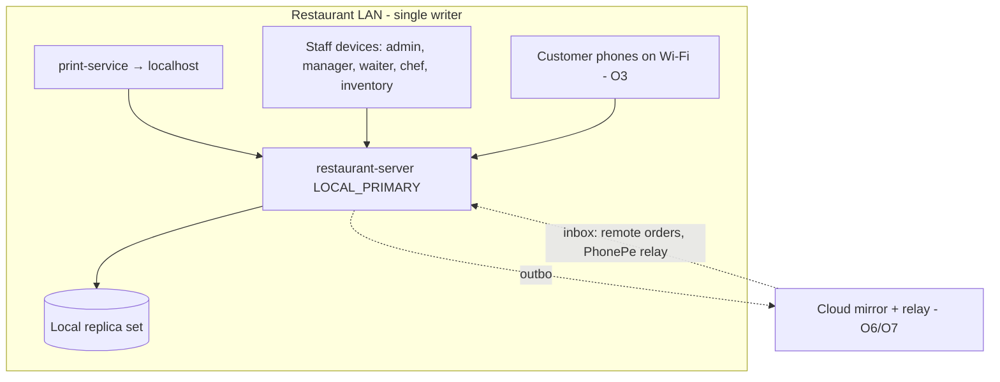
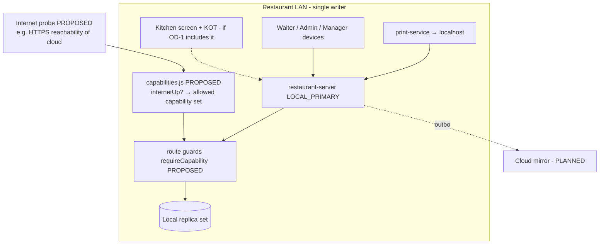
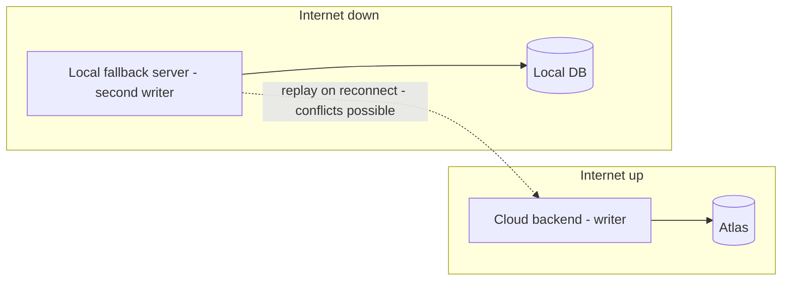

# 11 — Restricted vs Full Offline Architecture Comparison

**Everything in this document is PLANNED or PROPOSED** except the items marked IMPLEMENTED in §1. The choice between the options is **OD-1** and is the owner's.

## 1. What exists today

| Capability | Status |
|---|---|
| Staff apps show last-loaded data when the backend is unreachable; writes fail | IMPLEMENTED |
| Backend runs on a restaurant PC against a local replica set; apps served on the LAN | IMPLEMENTED (O1, uncommitted) |
| PIN login on approved devices; immediate revoke | IMPLEMENTED (O2, uncommitted) |
| Any connectivity-based restriction of functions | ABSENT |
| Sync to cloud | PLANNED, not approved |

## 2. The two requirement sets

| | **Restricted** (owner's stated requirement, BR-16) | **Full** (approved design, `docs/offline-edition/02` §3) |
|---|---|---|
| Waiter operations | ✓ | ✓ |
| Admin / manager operations | ✓ (which admin functions? see §5) | ✓ |
| Bill printing | ✓ | ✓ |
| KOT printing / kitchen screen | **not listed — OD-1** | ✓ |
| Chef app | ✗ (implied) | ✓ |
| Customer QR ordering on Wi-Fi | ✗ | ✓ (O3) |
| Inventory / purchases | ✗ (unless "admin operations" includes it) | ✓ |
| Delivery | ✗ | on-site only; remote via relay when online |
| Online payment (PhonePe) | ✗ | ✗ (never offline) |
| Push / SMS / maps / image upload | ✗ | ✗ / degraded |

Note: without KOT printing or the kitchen screen, orders taken offline would not reach the kitchen. The restricted list very likely needs KOT printing to be workable — confirm in OD-1.

## 3. Architecture options

### Option F — Full offline, local-primary (approved design)

### Option R1 — Restricted offline, local-primary + capability gate (PROPOSED)

Same infrastructure as F; add one server-side module (pattern of `config/deploymentMode.js`) that computes a **capability set** from connectivity, and route-level guards that refuse out-of-scope operations while offline.

### Option R2 — Restricted offline, cloud-primary with local failover (PROPOSED, not recommended)

Cloud stays the writer; when the internet fails, a local server takes over for waiter/admin/manager/bill printing and later pushes its writes to the cloud.

This makes **two writers** for one restaurant — the multi-master shape doc 02 rejected (order counter, KOT uniqueness, stock guards, idempotency would all need merge rules). Listed for completeness.

## 4. Comparison

| Criterion | F — Full | R1 — Restricted + gate | R2 — Failover |
|---|---|---|---|
| Matches stated requirement BR-16 | No (broader) | **Yes** | Yes |
| Matches approved decision D-12 (single writer) | Yes | Yes | **No** |
| New code beyond approved phases | none | capability module + guards + UI states + probe | failover, replay, conflict resolution |
| Risk to invariants (KOT once, stock, numbering) | none | none | high |
| Customer experience offline | can order over Wi-Fi (after O3) | cannot order | cannot order |
| Kitchen offline | works | depends on OD-1 | depends |
| Sync complexity | outbox up + inbox | same as F | two-way merge |
| Operational simplicity | one mode always | one mode + gate | mode switching under stress |
| Effort (beyond O1/O2) | O3–O9 | O4/O5/O9 + gate (≈ 1–2 weeks est.) without O3 | high; not estimated |
| Recommendation | if business wants everything offline | **if the restricted requirement stands** | not recommended |

## 5. Capability matrix for R1 (PROPOSED — to confirm with OD-1)

| Capability (route groups) | Online | Offline (R1) |
|---|---|---|
| Staff ordering, edit, accept, cancel (`/api/orders`, `/api/admin/orders/*`) | ✓ | ✓ |
| Kitchen send, KOT, kitchen screen (`sendToKitchenTx`, `/api/kitchen`) | ✓ | **OD-1** (recommended ✓) |
| Bill print, settle, cash/UPI/split payment, combined bill | ✓ | ✓ |
| Tables, sessions, waitlist | ✓ | ✓ |
| Attendance / duty | ✓ | ✓ (needed for waiter duty gate) |
| Menu availability toggles | ✓ | ✓ (proposed: allow sold-out toggles) |
| Menu/catalogue edits, employees, settings, coupons | ✓ | admin decides (proposed ✗ to keep cloud mirror simple) |
| Inventory purchases/adjustments | ✓ | ✗ (stock still deducts automatically if kitchen send is on) |
| Customer ordering (`/api/orders` by customer) | ✓ | ✗ |
| PhonePe, offers push, SMS, WhatsApp, Cloudinary, maps | ✓ | ✗ |
| Delivery dispatch | ✓ | ✗ |
| Insights / reports | ✓ | read-only ✓ |

Rules for the gate (PROPOSED): enforced on the server (never only in the UI); decided from a probe the server runs, not from the client; deny returns a distinct code (e.g. `OFFLINE_RESTRICTED`) that apps show as "not available offline"; every transition offline/online is logged.

## 6. Shared prerequisites (both F and R1)

O1/O2 committed and reviewed → O5 local HTTPS (staff) → O9 installer + automated backup + pepper recovery → O4 degrade internet-only services → O6/O7 sync (requires approval). F additionally needs O3 (LAN customer ordering) and O8 (rider claims).

## 7. Decision needed (OD-1)

1. Restricted or full?
2. If restricted: is KOT printing / kitchen screen included?
3. Which admin/manager functions count as "operations" offline?
4. Should customers see a "restaurant offline — please order with your waiter" message?
