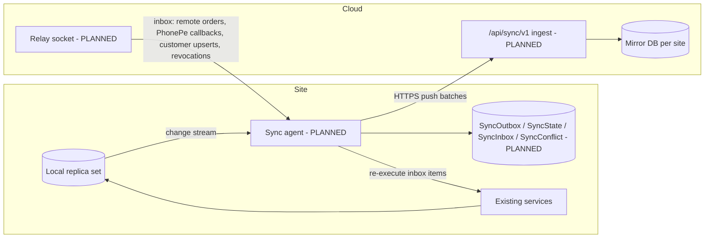
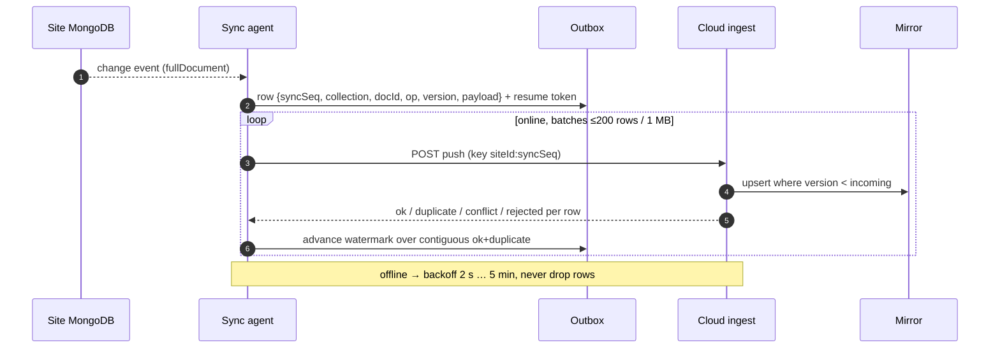
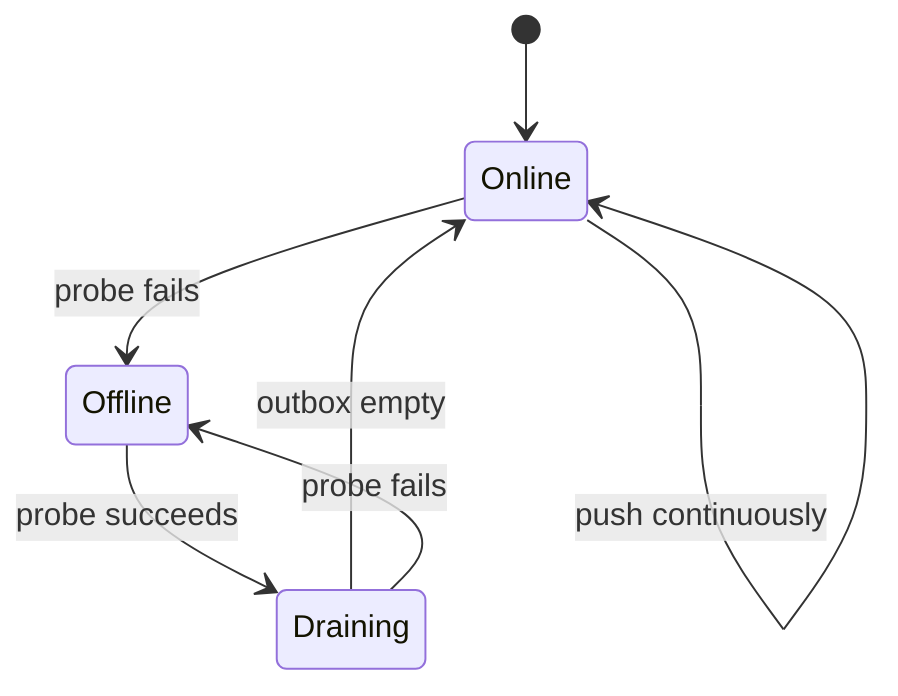

# 12 — Synchronization Architecture

**Status: PLANNED (design `docs/offline-edition/05-cloud-sync-strategy.md`), production sync NOT approved. No sync code exists.** This document restates the approved design for both offline options and adds the observations from discovery. Additions by this package are marked PROPOSED.

## 1. Principles (from doc 05)

1. The restaurant site is the **only writer** of its operational data.
2. Sync is **up-replication** site → cloud mirror, plus a small **inbox** cloud → site.
3. The cloud never answers on behalf of an offline site and never marks anything PAID.
4. Local operation never waits on sync.

## 2. Components

## 3. Up-sync sequence

## 4. Reconnect behaviour

During *Offline* the outbox grows; local operations continue (Option F: all; Option R1: capability-gated — see [11](11-offline-architecture-comparison.md)). On reconnect the agent drains in `syncSeq` order; the Admin → Sync page shows backlog age (PLANNED).

## 5. Conflict policy (doc 05 §9)

| Entity | Policy |
|---|---|
| Orders, KOT, payments, bills, stock, ledger, menu, tables, settings | site wins; cloud is read-only for LOCAL sites (`409 SITE_IS_LOCAL_PRIMARY`) |
| Customers | shared; upsert by phone; field-level last-writer-wins on profile fields |
| Employee deactivation issued in cloud | inbox command applied immediately (security exception) |
| Append-only collections | insert-only on mirror |
| Anything in `SyncConflict` | human resolution in Admin → Sync |

## 6. Option-specific notes

| | Option F | Option R1 |
|---|---|---|
| Outbox volume offline | all activity incl. customer orders, inventory | waiter/admin/manager + bills (+ KOT/stock if OD-1) |
| Inbox while offline | queued in cloud; remote orders refused with `503 SITE_OFFLINE` | same |
| Customer data | customers created on site (guest) and in cloud (Firebase) | cloud only |

## 7. Additions from discovery (PROPOSED)

* Exclude all `select:false` secrets: `PrinterDevice.keyHash`, `DeliveryJob.otpCode`, `StaffDevice.secretHash`, `StaffPin.pinHash`, `LocalSetupState.codeHash`.
* Collections without `updatedAt` (`Counter`, `DeliveryLocation`, `DeliveryEvent`, `LocalRateLimit`, `LocalAuthEvent`) need `_id`/`at`-based reconciliation.
* Decide whether TTL deletions are mirrored.
* Version compatibility check between site and cloud schema before accepting pushes.
* The leaked printer-key incident (R-01) shows credential handling must be designed first: per-site sync credential, rotatable, never in a file that can be committed.
