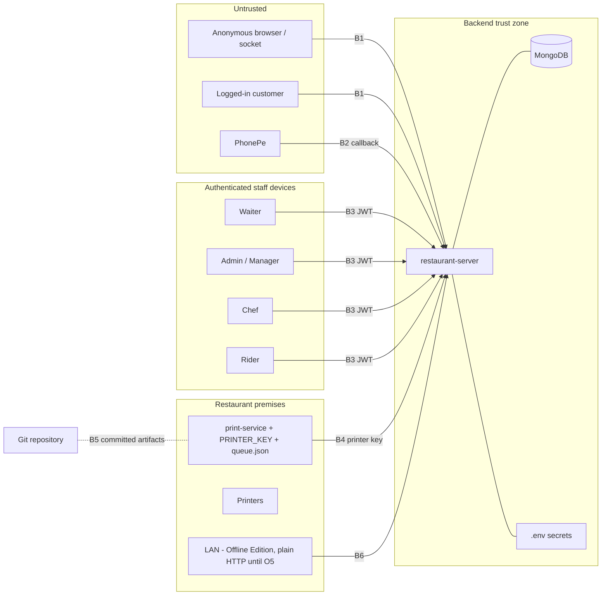
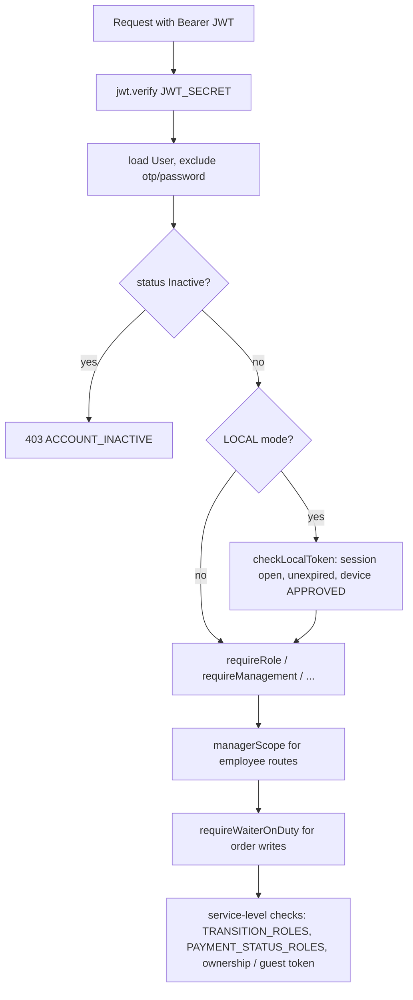

# 13 — Security Architecture and Threat Model

Method: STRIDE per trust boundary, using verified code only. No secret values are reproduced. Risk IDs follow `../22-technical-debt-and-risks.md`; DCA-Rxx = `docs/developer-collaboration-audit/RISK_REGISTER.md`.

## 1. Trust boundaries

## 2. Assets

Customer PII (names, phones, addresses), payment state and money, order and KOT integrity, stock, staff HR data (salary, ID last-4), credentials (JWT secret, PhonePe salt key, Firebase service account, printer keys, PIN pepper), print queue files, audit logs.

## 3. STRIDE analysis

| # | Boundary | Threat (STRIDE) | Existing control | Gap / finding | Risk | Proposed mitigation |
|---|---|---|---|---|---|---|
| T1 | B5 repo | **I**nformation disclosure / **S**poofing: printer key and customer PII in committed zips | none | `Admin_provider.zip`, `print-service/client-update-2026-10-10.zip` (.env with `PRINTER_KEY`, queue with names/phones) | **Critical** (R-01 = DCA-R01) | rotate keys (OD-3), remove artifacts, decide history purge, publish builds outside git |
| T2 | B1 socket | **I**: anonymous socket receives every order (PII, payment) | role rooms | legacy emits to `tenant` room (`socket.js:414,438,446`) | High (R-02) | delete legacy emits |
| T3 | B1 HTTP | **D**enial / abuse: unauthenticated WhatsApp send | — | `/api/test-whatsapp/:phone` | High (R-03) | delete route |
| T4 | B3 socket | **E**levation: deactivated staff keeps live data | REST checks `status` per request | cloud handshake skips Inactive (`socket.js:108-109`) | High (R-04) | check in both modes; disconnect on deactivate |
| T5 | B3 tokens | **S**poofing via stolen token | HS256, expiry | 7–30 d tokens in `localStorage`, no revocation in cloud | High (R-05) | shorter tokens, `tokenVersion`, httpOnly cookie for staff |
| T6 | B1 auth | **S**: OTP guessing / enumeration | send limit 5/h, verify tries 5, OTP 5 min | `Math.random`, in-memory, 403 vs 200 reveals staff phones | Medium (R-07) | `crypto.randomInt`, TTL store, uniform responses |
| T7 | B1 | **T**ampering: NoSQL operator injection | `sanitizeInput` strips `$` keys | — | Low | keep |
| T8 | B1 | **T**: price/amount/status tampering | server-side pricing, state machine, role maps | — | Low | keep |
| T9 | B2 | **S**: forged payment callback | `X-VERIFY` constant-time, amount match, final states | no IP allow-list | Low | optional allow-list (G12) |
| T10 | B1 | **R**epudiation of money actions | `paidBy/paidAt`, `statusHistory`, `billSettledBy` | no audit for settings changes or payment undo beyond history | Medium | admin audit log |
| T11 | B4 | **S**/**T**: rogue bridge reports fake PRINTED | key auth, only printer sockets can report | any holder of a key; two bridges double-print | Medium (R-20) | per-device lease, key rotation |
| T12 | B6 LAN | **I**: PINs/tokens over plain HTTP on Wi-Fi | LAN-only routes, device approval, lockout | HTTP until O5 | Medium | O5 HTTPS (approved strategy doc 12) |
| T13 | B6 | **E**: stolen staff device | device revoke immediate, session timeout | — | Low | keep |
| T14 | Server | **I**: error messages leak internals | stack only in development | raw `err.message` returned | Low | generic 500 messages |
| T15 | Server | **D**: request floods | per-route limits only on delivery | no global limiter, CORS `*` | Medium (R-08) | limiter on auth/order/payment, CORS allow-list, helmet |
| T16 | Kitchen | **I**: chef sees PII | stripped kitchen payloads | paper KOT prints name/phone (by design KH-08) | Accepted | — |
| T17 | Delivery | **I**: tracking link exposes rider/customer | signed revocable token, no OTP/phones in payload | — | Low | — |
| T18 | Public profile | **I** | — | full `RestaurantProfile` public (printer IPs etc.) | Low (R-16) | public projection |
| T19 | Supply chain | **T** | lockfiles | `npm audit` criticals/highs (fact sheet §9), no CI | Medium | CI with audit |

## 4. Authentication and authorization architecture

## 5. Security requirements for proposed features (PROPOSED)

| Feature | Requirement |
|---|---|
| Restricted offline gate | server-side enforcement; connectivity decided by the server; logged transitions |
| Sync | per-site rotatable credential; outbound only; exclude secrets; cloud write guard for LOCAL sites |
| Android print agent | enrolment + rotation, lease per job, no customer PII stored longer than needed |
| PhonePe V2 / refunds | webhook auth confirmed with real UAT sample; confirm by status call before PAID; refunds admin/manager only, idempotent |

## 6. Priority (PROPOSED order)

1. T1 key rotation (needs OD-3) · 2. T2 · 3. T3 · 4. T4 · 5. CI + dependency audit · 6. T5/T6/T15 hardening · 7. T12 via O5.
