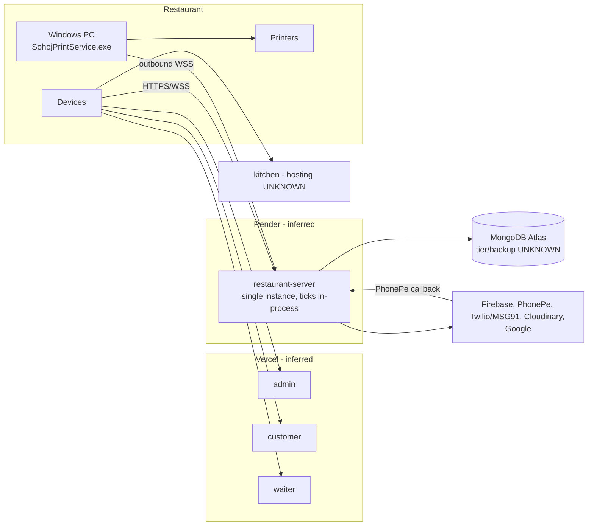
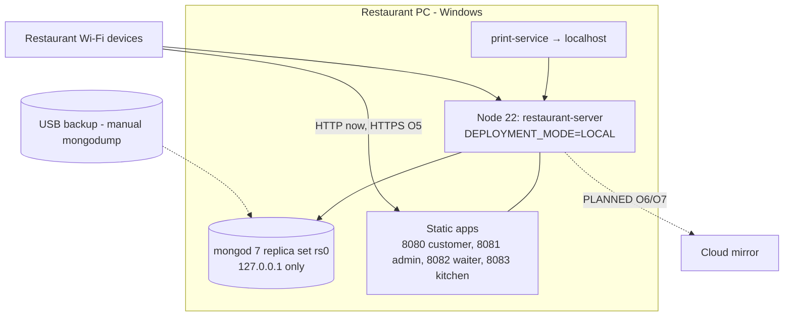
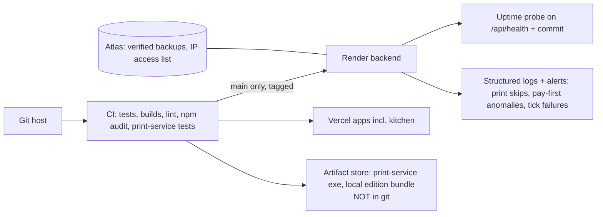

# 14 — Deployment Architecture

Verified from repo artifacts; hosting dashboards not accessed. Hostnames redacted.

## 1. Current production (inferred from repo — Medium confidence)

| Element | Evidence | Status |
|---|---|---|
| Render backend | `RENDER_GIT_COMMIT` in `server.js:118` | Inferred |
| Vercel apps | `admin|customer|waiter/vercel.json` | Inferred |
| Kitchen hosting | no config | UNKNOWN |
| Atlas | `mongodb+srv` handling | Inferred |
| Print bridge | `.exe` builds, `Admin_provider/` | Verified |
| CI/CD, Docker, IaC, monitoring | none | ABSENT |

## 2. Offline Edition (LOCAL_PRIMARY) — O1/O2 implemented, installer PLANNED

Setup today: manual (doc 11): install MongoDB as replica set (`scripts/localReplicaSet.js`), `.env` from `local-edition.env.example` (`DEPLOYMENT_MODE, LOCAL_PIN_PEPPER, LOCAL_SITE_ID, …`), build apps, open firewall, first-admin bootstrap code on the PC console. PLANNED O9: WinSW services, bundled Node + Mongo, firewall rules, scheduled backup, updater, recovery kit.

## 3. Environments

| Environment | Exists? | Evidence |
|---|---|---|
| Production cloud | yes (inferred) | |
| Staging | UNKNOWN / not in repo | |
| Local dev | `npm run dev` per app | `CLAUDE.md` Commands |
| Isolated sandbox backend | yes | `scripts/localSandbox.js` (in-memory replica set, console OTP) |
| Second copy on live DB | `DISABLE_BACKGROUND_JOBS=true` | `server.js:207` |

## 4. Configuration (names only)

See `../17-deployment-infrastructure.md` §3 for the full list. Secrets live in `.env` only; restaurant settings live in `RestaurantProfile`; frontends read `public/config.js` at runtime.

## 5. Proposed target deployment (PROPOSED)

| Item | Proposal |
|---|---|
| Branch → environment | `main` → production only; feature branches → preview/staging |
| Release record | deployed SHA from `/api/health` captured per release |
| Print-service / local edition distribution | signed artifacts outside git; key provisioning separate from the bundle |
| Backups | Atlas continuous backup verified by a restore drill; local scheduled `mongodump` + off-PC copy (O9) |
| Scaling | stay single instance (sufficient at ~200 orders/day); Redis adapter only if scaling out |
