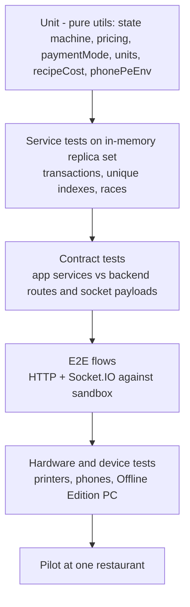

# 15 — Testing Strategy

## 1. Current state (verified file inventory; results quoted from earlier reports, not re-run)

| Suite | Location | Tooling | Last recorded result |
|---|---|---|---|
| Backend unit/integration | `restaurant-server/test/*.test.js` (73) + `fakeMongo.js` | plain Node + `assert`; `mongodb-memory-server` (incl. replica set) | 70/72 files pass; `editAfterKitchen`, `menuStructure` fail pre-existing (doc 10, 2026-11-20) |
| Backend e2e | `test/e2e/deliveryE2E.mjs` | real HTTP + Socket.IO against sandbox | 16/16 (delivery doc 04) |
| print-service | `print-service/test/` (13) | `npm test` | PASS (fact sheet) |
| admin | `floorState`, `menuCategories` | node | menuCategories FAIL |
| customer | `addonQuantity` | node | FAIL |
| waiter | `i18n`, `kotReleaseContract`, `orderDetailEdit`, `orderDraft`, `tableSession` | node | i18n FAIL |
| kitchen | `i18n` | node | PASS |
| delivery-app | `__tests__/geo.test.ts` | Jest | PASS |
| Builds | `vite build` ×4 | — | PASS (chunk-size warnings) |
| Lint | admin ESLint | — | FAIL on `main` (fact sheet) |
| Coverage, load, security scans, CI | — | — | ABSENT |

Strong areas already covered: order idempotency, edit window, edit after kitchen, pay-first, payment logic, split payment, KOT/print staleness, printer devices, inventory deduction/alerts, delivery races on a real replica set, Offline Edition boot/mode/auth, security config checks.

## 2. Strategy (PROPOSED)

| Level | Scope | Gate |
|---|---|---|
| Unit | every enum/state/pricing helper | CI, every PR |
| Service | every transactional/atomic path; concurrency (two actors racing) | CI |
| Contract | each app's `services/*.js` calls and socket listeners vs server routes/emits (prevents the listener drift found in discovery) | CI |
| E2E | critical journeys below | CI nightly |
| Security | `npm audit`, secret scan of the repo and artifacts, auth/RBAC negative tests, socket room membership tests | CI |
| Hardware | each certified printer model; Bengali, logo, QR, cut | before release of print-service |
| Offline | doc `offline-edition/08` matrix on real devices | before pilot |
| Performance | 200 orders/day ×10 burst test; tick latency | before go-live |

## 3. Critical journeys (E2E)

| ID | Journey | Key assertions |
|---|---|---|
| J1 | Customer QR dine-in → accept → auto-send → KOT printed → serve → bill → settle → complete | one KOT, stock deducted once, totals server-priced, COMPLETED only after PAID |
| J2 | Staff order with 0-minute window | immediate PREPARING + KOT |
| J3 | Edit after kitchen (add, remove) | change slip with only differences, revision bump, stock re-counted |
| J4 | PhonePe pay-first success / failure / amount mismatch / expiry | PAID only on verified match; AMOUNT_MISMATCH final; expiry cancels |
| J5 | Print bridge offline 10 min / 40 min | job prints after 10; after 40 skipped **and staff alerted (when implemented)** |
| J6 | Two staff accept the same order | one 409 |
| J7 | Delivery COD end to end | one CodCollection; PAID only after verify |
| J8 | Offline Edition: internet off, LAN on | in-scope operations work (per OD-1); out-of-scope refused with `OFFLINE_RESTRICTED` (if R1) |
| J9 | Sync drain after outage (when built) | no gaps, no duplicates, conflicts surfaced |
| J10 | Socket privacy | anonymous socket receives no order payloads (fails today — R-02) |

## 4. Fix-first test debt

1. Make the two failing backend suites and three failing frontend tests pass (fixtures for dining radius etc.).
2. Add a regression test for R-02 (anonymous socket receives nothing) and R-04 (Inactive socket refused).
3. Add the missing `requestKey` test for single bill print once implemented.

## 5. Environments for testing

`scripts/localSandbox.js` (isolated backend), `USE_MOCK_PRINTER=true` for print-service, PhonePe UAT credentials only, never production data (owner approval required for any import).
