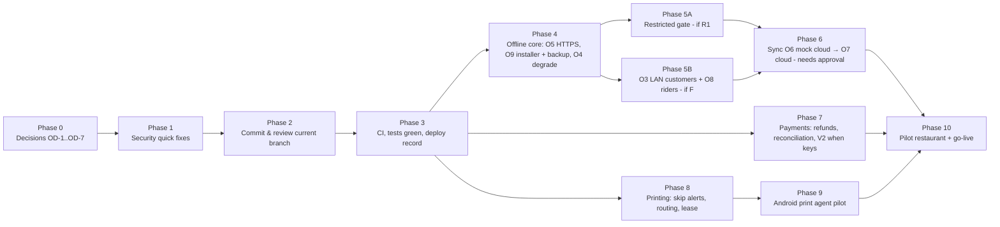

# 17 — Implementation Roadmap

**Every item here is PROPOSED** and needs owner approval. Owner rules that apply: stop after each phase for review; no commit, push or deploy without explicit approval; Offline Edition phases need explicit go-ahead; no production data without approval. Estimates are planning numbers only (Offline Edition estimates from `docs/offline-edition/07`).

## 1. Sequence

## 2. Phases

| Phase | Content | Depends on | Est. |
|---|---|---|---|
| 0 Decisions | OD-1 offline scope (+KOT), OD-2 guest ordering, OD-3 key rotation/history, OD-4 docs, OD-5 PhonePe, OD-6 charges, OD-7 Android | — | owner |
| 1 Security quick fixes | rotate printer keys (OD-3); remove legacy socket emits; delete test WhatsApp route; Inactive check on sockets; 404 fix; stop committing artifacts | OD-3 | 1–2 days |
| 2 Branch hygiene | review and commit O1/O2 + PhonePe hardening; merge plan for delivery/Inventory V3/PWA branches; update `CLAUDE.md`/README drift | owner approval to commit | 1–3 days |
| 3 CI & quality | CI pipeline (tests, builds, lint, audit, print-service); fix failing suites; contract tests for socket listeners; record deployed SHA | 2 | 3–5 days |
| 4 Offline core | O5 local HTTPS; O9 installer, services, scheduled backup, pepper recovery tool; O4 degrade internet-only services (PhonePe hidden, push/SMS skipped, local media) | 2, approval per phase | ≈ 3–4 weeks |
| 5A Restricted gate (if R1) | capability module, server probe, route guards, `OFFLINE_RESTRICTED` UX in apps | 4, OD-1 | ≈ 1–2 weeks |
| 5B Full offline (if F) | O3 LAN customer ordering (signed table tokens, LAN guest gate); O8 rider claims | 4, OD-1 | ≈ 2–3 weeks |
| 6 Sync | O6 outbox/change streams against a **mock cloud**; O7 cloud ingest/relay/inbox (**separate approval**) | 5A or 5B | ≈ 3–4 weeks |
| 7 Payments | refunds (G10), reconciliation (G8), admin re-check (G11), attempt history; V2 behind switch when credentials exist | 3, OD-5 | 1–2 weeks (+V2) |
| 8 Printing | skip alerts + configurable window; station routing; job lease; printer heartbeat alert | 3 | 1–2 weeks |
| 9 Android print agent | LAN-only single agent pilot on certified printer; reuse existing protocol; Windows kept | 8, OD-7 | per `docs/audit/…roadmap` |
| 10 Pilot | doc `offline-edition/08` matrix on real devices; hardware tests; rollback plan | 4–9 as chosen | 1–2 weeks |

## 3. Milestones and exit criteria

| Milestone | Exit criteria |
|---|---|
| M1 Safe baseline | R-01..R-04 closed; CI green; deployed SHA known |
| M2 Offline-capable site | staff work on LAN with HTTPS, installer, verified restore drill |
| M3 Offline scope enforced | J8 passes for the chosen option |
| M4 Synced | J9 passes against mock cloud; cloud module approved |
| M5 Payments complete | refund + reconciliation tests pass in UAT |
| M6 PC-free printing pilot | Android agent prints at pilot site with zero duplicates over N days |

## 4. Risks to the roadmap

Unanswered decisions (OD-1 most of all); uncommitted work on a local-only branch; manual deploys; hardware variety; PhonePe credential type; real-device GPS/print behaviour.
